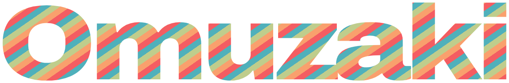

<p align="center">
  
</p>

<p align="center">
  <b>A free, open-source studio to build, perform and stream your VTuber.</b><br>
  Anything you can do in it, an AI agent can do too.
</p>

<p align="center">
  <a href="#licence"></a>
  <a href="https://github.com/dazsel/omuzaki/milestone/6"></a>
  
</p>

> [!WARNING]
> **There is no app to download yet.** What exists today is the engine underneath it: libraries, a command line and an
> MCP server, each with tests. The first thing you'll be able to try is the live slice: your webcam driving a character
> on screen and into OBS. Follow it on the [V0 milestone](https://github.com/dazsel/omuzaki/milestone/6).

## Where it stands

- ✅ **Projects are plain files.** A project is a folder of TOML files that diff cleanly in git. Every change is an operation you can preview before applying it, and undo within the same session.
- ✅ **Agents can do everything.** Each operation is a command on the `omuzaki` CLI and a tool on its MCP server, both generated from one registry.
- ✅ **A procedural character:** head, hair, body, outfit and accessories built from parameters, and a rig that poses any VRM humanoid skeleton.
- ✅ **A painted 2D face** (eyes, brows, mouth, nose, marks and expressions) driven by the 52 ARKit face shapes.
- ✅ **A toon renderer** on wgpu, with outlines. It also runs headless, so renders are tested.
- ✅ **VRM 1.0, VRM 0.x and glTF** import and export.
- ✅ **Webcam face tracking** with MediaPipe's face models, and **speech** with Silero VAD and Whisper, as libraries.
- ❌ **The live slice:** webcam → your character on screen → OBS. In progress ([V0](https://github.com/dazsel/omuzaki/milestone/6)).
- ❌ **The desktop app.** Its design system exists; the app around it doesn't yet.
- ❌ **Then:** streaming outputs, creating with agents inside the app, an AI performer, and sharing ([phases 2 to 5](https://github.com/dazsel/omuzaki/milestones)).

## Try the engine

You need Rust through [rustup](https://rustup.rs); `rust-toolchain.toml` pins the version. On Debian or Ubuntu, add the
system libraries for audio, input and windows:

```sh
sudo apt install pkg-config libasound2-dev libudev-dev libxkbcommon-dev libwayland-dev libx11-dev libxcb1-dev
```

Then:

```sh
git clone https://github.com/dazsel/omuzaki
cd omuzaki
cargo run -p omuzaki-cli -- ops                    # every operation: name, scope and summary
cargo run -p omuzaki-cli -- help face.set_style    # one operation's arguments, with types and ranges
```

## Use it from an AI agent

A project is a folder with a `project.toml`. Point any MCP client at `omuzaki --project <folder> mcp`. With Claude Code:

```sh
mkdir my-show && printf 'name = "My show"\nschema = 1\n' > my-show/project.toml
cargo build --release -p omuzaki-cli
claude mcp add omuzaki -- "$PWD/target/release/omuzaki" --project "$PWD/my-show" mcp
```

The agent can then list, preview and apply operations on that project, and undo them within its session. Each change
is saved to the folder as it is made.

## How it's built

A Rust workspace, built contract-first so many people (and agents) can work on it at once. Each area has a small API
crate with its types and traits, a mock crate that is a deterministic stand-in for tests, and implementation crates that
do the real work. `cargo xtask lint-deps` keeps implementations depending on contracts, never on each other, and
operations, part kinds and formats register themselves, so adding one never edits a shared list.

Start with [`crates/README.md`](crates/README.md) for the layout and [`docs/README.md`](docs/README.md) for the docs.
The full plan is the [spec](docs/product/02-studio-spec-v3.md): a plan, not a list of working features.

## Contributing

Bug reports and ideas are welcome: open an [issue](https://github.com/dazsel/omuzaki/issues/new/choose) for a bug, or
start a [discussion](https://github.com/dazsel/omuzaki/discussions) for an idea. **We aren't taking code contributions
yet:** pull requests from outside the Dazsel organisation are closed automatically while the contracts settle.
[`CONTRIBUTING.md`](CONTRIBUTING.md) explains why and how to report a bug; [`SECURITY.md`](SECURITY.md) covers
vulnerabilities. AI coding agents should read [`AGENTS.md`](AGENTS.md).

## Licence

Licensed under either of [Apache-2.0](LICENSE-APACHE) or [MIT](LICENSE-MIT), at your option. Dependencies, models and
assets keep their own licences, and nothing with a non-commercial licence is ever used
([policy](docs/licensing/policy.md)).

Omuzaki and Dazsel are trademarks of [Dazsel](https://dazsel.com); the code licence doesn't cover the names or logos
([TRADEMARKS.md](TRADEMARKS.md)).
