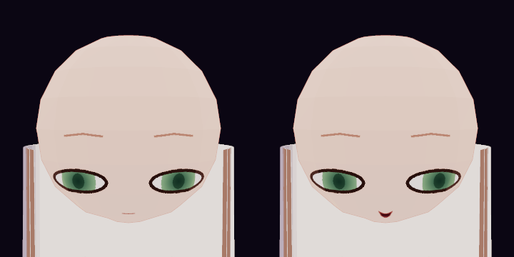
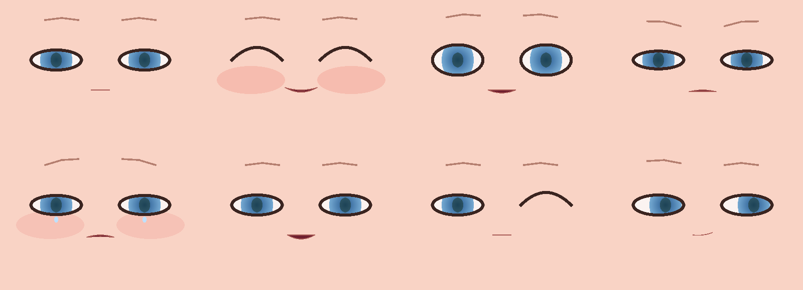

# Character and face API: `omuzaki-char-api` and `omuzaki-face-api`

**Status:** proposed. **Crates:** `crates/omuzaki-face-api`, `crates/omuzaki-face-mock`, `crates/omuzaki-char-api`, `crates/omuzaki-char-mock`.
**Spec:** v3 §18 (Character Builder), §19 (face and expression), §32 (how to make better characters), §33 (lessons), §39.1 rules 1 to 3 and 6.
**Prototype it comes from:** the JS prototype's character parts (`head.js`, `face.js`, `hair.js`, and `body.js`, `uniform*.js`, `robe*.js`, `boots.js` for outfit parts), `arkit.js`, `life.js` and its expression engine.

This contract is built on merged neighbours and says so where it matters: the **channel table is owned by `omuzaki-anim-api`** (a project decision), and the renderer, `Colour` and `MeshData` live in `omuzaki-render-api` and `omuzaki-core`. **Parameter types are `f64`** (project policy: JSON numbers are `f64`, so files and agents never see `0.6000000238418579`); real-time data (the channel bus, `PaintParams`, draw lists, meshes) is `f32`, converted at the boundary by `omuzaki_face_api::narrow`.

## In one minute

A character is **parts on a standard skeleton** plus a **painted face**. Two crates describe it:

- `omuzaki-face-api` is *what the face does*. It reads the ARKit-native channel bus (`ChannelBuf`, from anim-api), turns it into **paint parameters** with a per-character `FaceMapping`, and defines the **painter contract**: a pure function from paint parameters to **vector draw lists**, one per layer. It also owns the face profile (eye, brow, mouth, nose, cheek designers), expressions and visemes.
- `omuzaki-char-api` is *what the character is*. A `CharacterDef` is a map of parts (a tree through `parent` links) plus a palette and the face profile. Part kinds **register themselves**, carry typed parameter structs that double as file format, schema and validation, and **build** meshes, materials and (for hair) a simulation. Variants are small sets of path overrides.

```text
 bus (anim-api)                          face-api                                         render-api (merged)
 ──────────────                          ────────                                         ───────────────────
 ChannelBuf ──FaceMapping::apply──▶ PaintParams ──FacePainter::paint──▶ DrawList ×3 layers
 (52 ARKit + extras, per frame)       (Copy, 188 B)                     (vector, reused)
                                                                              │ FaceRasterizer (CPU) or GPU Vello/SDF
                                                                              ▼
                                                              premultiplied sRGB pixels ──▶ Painter / PaintTarget::write_rgba
                                                                                              │  paint_texture(layer_texture)
 char-api                                                                                     ▼
 ───────                                                                         dynamic texture ◀── Overlay { Planar mapping }
 CharacterDef ──RegistryBuilder──▶ BuiltCharacter ── MeshData + MaterialSpec ──▶ stage ──▶ create_mesh / create_material
 (parts, palette, face)  (variant first)   meshes, materials, textures, runtimes, face binding        instances, render
```

`crates/omuzaki-char-mock/tests/stage.rs` runs this whole picture against the real `omuzaki-render-mock`: the mock character is built, its face layers are painted through the renderer's `Painter`, and the frame is rendered. The face reaches the screen through an overlay and changes when channels change:



*Left: neutral. Right: `jawOpen`, both `mouthSmile`, `eyeLookOutLeft`. The head is an ellipsoid, the garment below is the layered torso tube, the face is the painted overlay. Hair hangs behind the head and isn't in view. Colours are shifted by the toon skin treatment (decision Q9 below).*

## Decisions and why

| # | Decision | Why | Rejected |
|---|---|---|---|
| D1 | **The face reads the ARKit-native bus and owns the mapping to shapes.** `FaceMapping::apply(&ChannelBuf) -> PaintParams`, coefficients stored in the face profile. | Project decision; FE-01. One vocabulary for trackers, scores, lip sync, the life layer and VRM export (perfect sync is the identity map). The smile and brow formulas are a property of a face, so a character can exaggerate or tame them (FE-06) with plain numbers. | Painter-specific semantic channels on the bus (the prototype's bus); mapping inside the retargeter. |
| D2 | **`PaintParams` is a fixed-size `Copy` struct, not a second channel table.** | The painter wants "left eye openness", not index arithmetic; named fields can't be mixed up. 192 bytes, so nothing allocates between bus and painter. Mapped once per frame by the caller, so the live face, a VRM bake and a thumbnail agree. | Painters reading `ChannelBuf` directly (every painter re-derives the formulas). |
| D3 | **The painter outputs vector `DrawList`s, resolution independent, in face-plane metres.** | CB-24 "crisp at any zoom"; plain CPU maths that is deterministic and golden-testable without a GPU; the same list feeds a CPU rasteriser (tests, WASM fallback) and a GPU one (Vello or SDF, ≤ 0.5 ms). Lists are reused: no allocation once warm. A `fingerprint()` says when a layer changed. | A fixed-resolution canvas (the prototype's); a GPU-only painter with no testable middle. |
| D4 | **The face composites as renderer `Overlay`s; layers and their compositing are fixed by the contract.** `Base` on the skin (soft front fade, strength 1), `Brows` on the hair (hard cut, 0.85), `Overlay` reserved. | Matches `docs/design/render-api.md` ("Face painter compositing"). Brows through bangs (CB-21) need no special case. The numbers are the prototype's, verified there. | A special face slot in the renderer; per-character compositing settings. |
| D5 | **Atlas resolution is a runtime knob, not a profile field.** `FaceLayerSpec::px_per_m`, brows at half. | The scheduler shrinks it under load (render-api's degrade ladder); the vector list stays crisp at any size. A profile that fixed it would couple the look to the machine. | A resolution field in `face.toml`. |
| D6 | **Parts are a map keyed by `PartId` with `parent` links, not nested arrays.** | The project must merge and patch exactly (`omuzaki-doc-api` arrays only change in place or at the end). Every part has a stable path (`characters/<id>/parts/<part>/params/...`); reparenting or reordering is one field. | Nested arrays; positional ids. |
| D7 | **Part kinds register themselves (`register_part_kind!`) and their typed `Params` struct is the single source of truth.** Serde form = file format, `JsonSchema` = what ops and agents read, `Validate` = what rejects bad edits. | §39 rule 2 (no central list), the pattern ops already use. Adding a garment is one file. | A central `enum PartKind` (every garment edits the API crate); untyped parameter bags. |
| D8 | **`head`, `hair` and `body` parameter structs live in this API crate; garments and accessories live in their own crates.** | Head, hair and face interlock (surface directions, face window, brows through hair) and are the identity of a character, so their file format is a contract that several streams build against at once. Garments are leaf generators that cross-talk only through the published fit stack. | Everything in impl crates (the project format changes without review); everything in the API (every garment edits it). |
| D9 | **Parts talk to each other only through what they publish** (`HeadSurface`, `FaceProjection`, a `BodyFit` stack, anchors), never through each other's parameters. | A part can be rebuilt, replaced or mocked alone; garment layering is a stack of envelopes, each wrapping the one under it (CB-40, CB-42). | Parts reading a shared mutable context (the prototype's `ctx.shared`). |
| D10 | **Build order is derived: parent, lower `layer`, required kinds; ties by `(layer, id)`.** Contradictions are a named `Cycle` error. | Deterministic and explainable; inner garments build before outer ones with no manual ordering. | Explicit order numbers (merge conflicts); build in file order. |
| D11 | **Randomness is per part:** `Rng::new(seed).fork(FNV(part id))`. | A rebuild is identical, and adding a part never shifts another part's hair (the prototype's global LCG did). | One RNG threaded through the build. |
| D12 | **Materials use the renderer's own parameter types** (`Shading`, `Outline`, `AlphaMode`); `MaterialSpec` differs from `Material` only by naming textures and face layers instead of holding handles. `to_material` is the one conversion. | No duplicate type, no per-part glue in the stage; a palette slot resolves when the part builds (`BuildCtx::colour`). | Own toon types (drift); inline handles (parts can't build before upload). |
| D13 | **Hair is groups of generators that compile to clumps.** Guide points are anchored to the head surface (`theta`, `phi`, offset) so a head-shape change reshapes the hair. | The clump is the common currency for generators, physics, tube geometry and the glTF bake; hand-edited guide curves (CB-32) are just a `guides` group. | One generator per hairstyle (not editable); free-space points only (a close-up face would need a different hairstyle). |
| D14 | **A variant is a set of path overrides**, resolved by applying them to a copy of the character and re-validating through the typed structs. | A few readable lines that merge cleanly; the base flows into every variant; the same path mechanism that edits the document addresses them; a mistyped path is an error naming the override, never a silent no-op. | A second copy of the character per variant. |
| D15 | **Face-shape presets are library data; the document stores explicit numbers.** | Undo is exact, variants override single fields, a character doesn't change when the preset library is edited. `face.set_profile` blends a preset into the current numbers and writes both places in one transaction. | Storing a preset id and blend weight (two sources of truth). |

## Where things live

| Crate | Kind | Holds | Depends on |
|---|---|---|---|
| `omuzaki-face-api` | API | `FaceMapping`, `PaintParams`, `FaceProfile` and its designers, `ExpressionSet`, `FacePainter`, `DrawList`, `FaceRasterizer`, palette slots, `Validate`, the baker registry (`FaceBakerFactory`, `face_baker()`) | `omuzaki-core`, `omuzaki-anim-api` (channels), `omuzaki-io-api` (`ExpressionBaker`) |
| `omuzaki-face-mock` | Mock | `MockPainter`, `MockRasterizer` (scanline: fills, clips, transforms, gradients, strokes), `mock_profile`, `MockFaceBakerFactory` (a trivial registered baker), a contact-sheet example | face-api, anim-api, io-api (dev: io-mock) |
| `omuzaki-char-api` | API | ids, `CharacterDef` and the part tree, `PartKind` and registration, `BuildCtx`, published surfaces, `BuiltCharacter`, `PartRuntime`, variants, `HeadParams`, `HairParams`, `BodyParams`, shape profiles | core, face-api, anim-api (`HumanoidBone`), render-api (material types), store-api (`ContentHash`), doc-api (`DocPath`, `Value`) |
| `omuzaki-char-mock` | Mock | four registered kinds that take the **real** `HeadParams`, `HairParams`, `BodyParams`; a readable character and variants as JSON fixtures; `MockLive`, a frame loop; the end-to-end stage test | char-api, face-api, anim-api, render-api (dev: face-mock, render-mock) |

No contract changes anywhere else. Two small things sit in the wrong place for now and are listed as questions: `ExpressionId` (declared by anim-api, used here) and the `ParamError`/`Validate` helper (in face-api, used by char-api; `omuzaki-core` would be its natural home).

## Conventions

| Thing | Rule |
|---|---|
| Numbers | **Parameter structs (anything stored in the document or edited by an op) are `f64`.** Real-time data is `f32`: `ChannelBuf`, `PaintParams`, `DrawList`, `MeshData`, `FaceProjection`. `FaceMapping::apply`, `HeadParams::face_projection`, `GuidePoint::resolve` and `Taper::at` narrow at the boundary; painters call `narrow` when they read the profile. Tests assert `0.6` serialises as `0.6`. |
| Units | Metres, radians (except hair guide angles and layout tilts, written in degrees or unitless factors where the field says so), weights `0..=1`. |
| Axes | Right-handed, +Y up, a character faces +Z. **Left is the character's own left: +X**, on the viewer's right when it faces the camera. ARKit's `Left` means the same. |
| Frames | **Bind space** (template skeleton, metres) for geometry; **head-local** (origin: head centre, bind-space axes) for head, face layout and surface-anchored hair; **face plane** = head-local x and y. `FaceProjection::planar` moves a window from head-local into bind space for the renderer. |
| Surface angles | `theta` from the top of the head (0) to the chin (180); `phi` from the front (0) toward the character's left (+90) to the back (180); offset in metres along the radial direction. |
| Names | Ids are slugs (`a-z`, `0-9`, `-`, `_`). Channel names are anim-api's camelCase ARKit names. Wire names of parameters are `snake_case`. Joint references are `{"humanoid": "head"}` (VRM role) or `{"named": "hair_back_2"}`. |
| Colours | `omuzaki_core::colour::Colour` in built data. In parameter structs a `ColourRef`: `#rrggbb[aa]` or `@palette_slot`. |
| Determinism | Builds and paints are pure: same inputs, same bytes. Hashes use hand-rolled FNV, never `std` hashers. |
| Errors | `ParamErrors` lists every invalid field with a `/`-separated path (`eyes/iris/width`); `BuildError` names the part. |

## The face

### What the face reads from the bus

Every ARKit channel and every anime extra reaches at least one paint parameter, except three. Head, body and `custom` channels are not the face's business (the pose stage and character-specific toggles use them). A test (`mapping::tests::every_arkit_channel_and_anime_extra_moves_the_face_except_the_three_unmapped`) proves this against the real table, so a channel can't silently go dead.

| Channel(s) | Paint parameter | Coefficients (`mapping.*`) |
|---|---|---|
| `eyeBlink*` | `left_eye.close`, `right_eye.close` | none (identity) |
| `eyeArc*` | `left_eye.arc`, `right_eye.arc` | none |
| `eyeWide*`, `eyeSquint*` | `*_eye.open` | `eyes.wide`, `eyes.squint`; base `rest.eye_open` |
| `eyeSquint*`, `cheekSquint*` | `*_eye.lower_lid` | `eyes.squint_lid`, `eyes.cheek_lid`; base `rest.lower_lid` |
| `eyeLookUp*`, `eyeLookDown*`, `eyeLookIn*`, `eyeLookOut*` | `gaze` (look units), `vergence` | `gaze.x`, `gaze.y`; vergence is mean *in* minus mean *out* |
| `browInnerUp`, `browOuterUp*`, `browDown*`, `noseSneer*` | `*_brow.height`, `*_brow.tilt`, `brow_arch` | `brows.*` (9 numbers); bases `rest.brow_*` |
| brows (derived) | `eye_tilt` | `eyes.tilt_from_brows` (0 turns it off) |
| `eyesShock` | `effects.shock`, shrinks `pupil` | `eyes.shock_pupil`; base `rest.pupil` |
| `eyeTilt` (signed) | adds to `eye_tilt`: `-1..=1` spans the painter's `-2..=2` | none (`EYE_TILT_PER_UNIT`) |
| `browArch` (signed) | adds to `brow_arch` | none |
| `pupilSize` | shrinks `pupil`, to 40% at 1 (pinpoint) | none (`PINPOINT`); multiplies with the `eyesShock` shrink |
| `eyesHeart`, `eyesStar`, `eyesGloom`, `eyesSqueeze`, `eyesSpiral`, `sparkle`, `tears` | `effects.*` | none |
| `eyesBlank`, `eyesDot`, `eyesPill` (#2404, #2405) | `effects.blank`, `effects.dot`, `effects.pill` | none |
| `eyesStare` (#2404) | `effects.stare`, and widens `*_eye.open` | `eyes.stare_open` |
| `jawOpen`, `mouthClose` | `mouth.open` | `mouth.open`, `mouth.close_cancel` |
| `mouthSmile*`, `mouthFrown*`, `mouthDimple*` | `mouth.smile_left`, `mouth.smile_right`; also widen the mouth and gate lower teeth | `mouth.smile`, `mouth.frown`, `mouth.dimple`, `mouth.wide_smile`; base `rest.mouth_smile` |
| `mouthStretch*`, `mouthPucker` | `mouth.wide` | `mouth.stretch`, `mouth.wide_pucker`; base `rest.mouth_wide` |
| `mouthFunnel` | `mouth.round` | `mouth.round` |
| `mouthPucker`, `jawOpen` | `mouth.pucker` (fades as the jaw opens) | `mouth.pucker_start`, `mouth.pucker_gain` |
| `mouthLeft`, `mouthRight`, `jawLeft`, `jawRight` | `mouth.shift` | `mouth.shift_mouth`, `mouth.shift_jaw` |
| `mouthPress*`, `mouthRollLower`, `mouthRollUpper`, `mouthClose` | `mouth.press` | `mouth.press*` (4 numbers) |
| `mouthUpperUp*` | `mouth.teeth_upper` | `mouth.teeth_start`, `mouth.teeth_gain` |
| `mouthLowerDown*` | `mouth.teeth_lower` (only on a real smile: a toothy grin, as in the prototype) | `mouth.teeth_lower_*` (4 numbers) |
| `tongueOut`, `fangs`, `teethSharp` | `mouth.tongue`, `mouth.fangs`, `mouth.teeth_sharp` | none |
| `cheekPuff`, `cheekSquint*`, `blush` | `blush`, `cheek_puff` | `cheeks.puff_blush`, `cheeks.squint_blush`, `cheeks.blush`; base `rest.blush` |
| `sweatDrop` | `sweat` | none |
| `angerVein` (#2403) | `anger_vein` | none |
| every `ARKit` channel, before the rows above | the channel itself | `amplify.knee`, `amplify.gain`: the subtle-movement expander (FE-06), off by default. Below the knee a channel is multiplied by the gain, above it the curve runs straight to 1. Per-channel response curves are retarget calibration (PF-22), not this. |

**No painted effect (`UNMAPPED`):** `jawForward`, `mouthShrugLower`, `mouthShrugUpper`. They move lips in depth, which a front-facing 2D face can't show. They stay in the bus (trackers send them), painters ignore them, and a VRM bake writes empty targets for them (perfect sync lists them as inert, which io-api allows). Art can decide to give them a small effect (question Q3).

The formulas are the prototype's (`arkit.js` lines 140 to 190), moved from the retargeter to here. The default coefficients reproduce them exactly: a one-sided `mouthSmileLeft = 0.8` gives `smile_left = 1.35 × 0.8`; `mouthClose` cancels 35% of itself from the jaw; a kiss fades as the jaw opens. Tests hold these, plus: **mirroring the bus mirrors the result** (`PaintParams::mirrored`), and outputs stay in range even for wild input.

### The signed face shapes (#74)

Three prototype parameters are set only by expressions and scores, with no ARKit counterpart: the lid tilt, the brow
arch and the pupil size. `omuzaki-anim-api` gives them channels 73 to 75, `eyeTilt` and `browArch` signed (`-1..=1`)
and `pupilSize` `0..=1`, so the prototype's expression library ports without loss. Each adds to what the mapping
derives from the other channels (the brows still tilt the lids, `eyesShock` still shrinks the pupil), inside the
painter's ranges.

### Paint parameters

`PaintParams` (all fields `Copy`, documented in rustdoc with their ranges):

| Field | Meaning |
|---|---|
| `left_eye`, `right_eye`: `EyeParams { open, close, arc, lower_lid }` | Lids per eye. An arc closes the lid as well: the eye is shut when `max(close, arc)` is near 1, and drawn as ^ when `arc >= 0.5`. |
| `eye_tilt`, `pupil`, `gaze: Vec2`, `vergence` | Shared eye state. |
| `effects: EyeEffects` | Heart, star, gloom, shock, squeeze, spiral, sparkle, tears, blank, dot, stare, pill. |
| `left_brow`, `right_brow`: `BrowParams { height, tilt }`, `brow_arch` | Brows. |
| `mouth: MouthParams` | Open, wide, per-corner lift (absolute), round, shift, press, pucker, teeth, tongue, fangs, sharp teeth. |
| `blush`, `cheek_puff`, `sweat`, `anger_vein` | Face surface and the marks in front of the hair. |

### The face profile (`face.toml`)

Everything below is `serde` + `JsonSchema` with `deny_unknown_fields` and defaults, so a file lists only what differs from a generic anime face, and a typo fails loudly. Lengths are head-local metres. `FaceProfile::validate` reports every bad field by path.

| Section | What | Spec |
|---|---|---|
| `layout` | eye line, eye spacing and width, brow gap, nose, mouth, blush heights and spacing; `ratios(chin_y)` gives the head-size-independent view | CB-12 |
| `eyes` | `scale`, `drop`; `aperture` (roundness, tilt, corner shapes, lid height), `lash` (thickness, flick, lower lash, inner tick), `crease`, `iris` (size, inset, gradient colours, ring, gaze travel, `pupil` shape and size), `right_iris` (the right eye's own colours and pupil, each defaulting to `iris`: heterochromia, #2407), `sclera`, `highlights` (shape blob/star/heart, size, offset, second light, shimmer, view motion), `lower_lid` (line, cheek line), `lid_shadow`, `tear` | CB-20 |
| `brows` | inner and outer x, thickness, arch, colour, `through_hair` | CB-21 |
| `mouth` | half width, closed and open scale, line width and colour, corner curve, `lips` (rim and gloss), `interior` (mouth, tongue, teeth colours), `fang` (`none`, `both`, `one_left` or `one_right`; `pointed` reads as `both`) | CB-22 |
| `nose` | none, dot or tick; size, colour | CB-23 |
| `cheeks` | soft or hatched blush, radius, strength, warm wash | CB-23 |
| `marks` | freckles, beauty marks, face paint, scars | CB-23 |
| `effects` | the anime marks' looks: `anger_vein` (side, size, place, fill and outline colours) | FE-02 |
| `mapping` | `rest` (the resting face in paint terms) and the coefficients above | FE-06 |
| `rest` | channel values the `rest` bus layer starts from (usually empty) | |
| `expressions` | named expressions and visemes | FE-03 |
| `grammar` | anime grammar rule switches: a map from rule id to `enabled`, `strength` (0 to 2) and `params`; an absent rule runs at its default (on, strength 1). The reserved ids are `smile-blink-arc`, `laugh-squint`, `pout-cheek-puff`, `grin-fangs`; the grammar stage in `omuzaki-anim` runs them | FE-05 |

### Expressions and visemes

An expression is `{ kind, deltas: {channel: value}, curve }` in the bus's own vocabulary. `ExpressionSet::blend(base, weights)` adds scaled deltas and sanitises (clamps to the channel ranges); expressions add, so `happy` plus `aa` composes with no priority rule. The five **visemes** have the VRM preset names (`aa`, `ih`, `ou`, `ee`, `oh`), so a lip-sync source and a VRM export agree. `ExpressionSet::starter()` supplies the visemes, `blink` and five moods (`happy`, `angry`, `sad`, `relaxed`, `surprised`) as channel recipes. A test checks they land where the prototype's did: the five visemes open the mouth by 0.85, 0.62, 0.42, 0.32, 0.28 within 0.03 through the default mapping. FE-04 tunes the moods.

**Playback (FE-03).** An expression may carry `playback = { fade_in_s, fade_out_s, auto_stop_s, group, layer, dwell_s, cuts_in }`. It says how the expression plays when a trigger shows it; the default (in 0.12 s, out 0.2 s, held, no group, no auto-stop) is left out of files. `group` makes expressions exclusive: showing one fades out the others in its group. `layer = "momentary"` plays over the held expressions. On each channel the momentary one moves, the held ones step back by its weight, so a wink takes the eye from a smile and gives it back when it ends. The profile's `default_expression` (a mood or an accent) fills in where nothing held shows. `omuzaki_face::player::ExpressionPlayer` runs all of this without allocating per frame, and the trigger runtime (PF-25) decides when to show and hide. `dwell_s` is the least time an expression holds before another in its group replaces it: one asked for sooner waits (the latest asked for wins) and shows when the dwell is up, and showing the expression that is up again renews it, so the hold extends instead of the fade restarting. `cuts_in` lets an expression replace another through its dwell, as a startle does; a cut (`ExpressionPlayer::cut`) ignores dwell. In the built-in library every mood is in the group `mood` and dwells 1.1 s, its fades follow its family (alert faces 0.12 s in and 0.3 s out, cutting in; warm faces 0.3 s and 0.42 s; down faces 0.45 s and 0.6 s; the rest 0.12 s and 0.2 s), and the accents are momentary with an auto-stop. Lip sync and scores give weights directly and skip playback.



*`cargo run -p omuzaki-face-mock --example sweep`: the starter expressions through the default mapping and the mock painter. Row one: neutral, happy, surprised, angry. Row two: sad, `aa`, wink (`eyeBlinkLeft` + `eyeArcLeft`), smirk and glance. The mock draws about a third of what the real painter will; it exists so every seam can be tested.*

### The painter contract

| Piece | Contract |
|---|---|
| `FacePainter` | `layers() -> &[FaceLayerSpec]`; `paint(&FaceInput, &mut FaceDrawing)`. Real-time: no allocation once the lists have warmed up, no locks, a pure function of its input. `FaceInput { profile, params: &PaintParams, time, view }`; `time` is the shot clock (twinkle and shimmer), never the wall clock. |
| `FaceDrawing` | One `DrawList` per layer, owned by the caller and reused. `fingerprints()` lets the stage repaint only layers that changed (the prototype redrew only when the face changed). |
| `DrawList` | `Fill`, `Stroke`, `PushClip`/`PopClip`, `PushTransform`/`PopTransform` over paths (`Move`, `Line`, `Quad`, `Cubic`, `Close`; `ellipse` helper) with `Solid`, `Linear` and `Radial` paints (up to four stops, inline). Non-zero fill. Face-plane metres. `Serialize`, so a golden can store the list. |
| `FaceRasterizer` | CPU: `rasterize(spec, list, px_per_m, &mut Raster)`. **Premultiplied RGBA8, colour blended in sRGB** (like the prototype's canvas), row 0 is the top of `spec.rect`. The mock implements it; `omuzaki-face` adds a GPU one that draws into `PaintTarget::native()`. |
| Layers | `Base` → skin material, soft fade, strength 1. `Brows` → hair material, hard cut, strength 0.85 (half-density texture). `Overlay` → reserved (in front of hair: sweat, gloom lines). `FaceLayerId::composite()` is the one place these numbers live. |
| Density | `FaceLayerSpec::for_layer(id, &projection, px_per_m)`; `DEFAULT_PX_PER_M = 3600` gives the prototype's 1 536 px face and 768 px brows. A runtime knob (D5). |

**How it meets the renderer** (no render-api type appears in face-api; `omuzaki-face` does the wrapping):

```rust
// In omuzaki-face (sketch, tested in stage.rs): the renderer's Painter around a draw list and a rasteriser.
struct FaceLayerPainter<'a> { spec: FaceLayerSpec, list: &'a DrawList }
impl Painter for FaceLayerPainter<'_> {
    fn paint(&mut self, target: &mut dyn PaintTarget) -> Result<(), RenderError> {
        // GPU path first: downcast target.native() and draw the list; fall back to the CPU raster.
        let mut raster = Raster::new(1, 1);
        rasteriser.rasterize(&self.spec, self.list, self.spec.px_per_m, &mut raster)?;
        target.write_rgba(PixelRect::full(target.desc().size), &raster.pixels)
    }
}
```

`face_texture_desc(&spec)` (char-api) gives the dynamic, premultiplied, sRGB, mip-mapped, anisotropy-8 texture each layer needs, and `BuiltCharacter::face_textures(px_per_m)` lists exactly the layers some material composites. The head material then carries `FaceOverlay::of(&projection, head_centre, Base)`, which `to_overlay(texture)` turns into the renderer's `Overlay { Mapping::Planar { min, max, fade_from, fade_to }, strength }` field for field.

**Palette and the painter.** A face profile may name colours by palette slot (`@eyes`), but a painter never sees a slot. `FaceInput::profile` and `FaceBinding::profile` are slot-free: the stage calls `FaceProfile::resolve_colours(&palette)` before painting and again whenever the palette changes, so every painter, the GPU one included, reads plain colours. `resolve_colours` walks the profile's JSON and replaces each `@slot` by its colour, so a colour field added later is resolved with no change to the resolver. An unknown slot is an error that names its JSON path (`eyes/iris/top`). `FaceProfile::slots_used()` lists the slots a profile names, for the contrast checker and the palette UI.

**The view.** `FaceView` carries what depends on the camera, which the stage works out each frame: `highlight_shift`
(the eyes' reflections slide opposite the direction the camera sees the face from, #174) and `head_coverage` (the
head's height over the frame's height at the head). The mouth reads `head_coverage` (#464): in a wide shot, at most
`WIDE_SHOT` (0.12) of the frame, it grows by `mouth.wide_shot_scale` (default 1.4: width, opening and the line's weight
by its square root), so lip sync still reads when the head is a few dozen pixels tall; it eases back to its own size by
`CLOSE_SHOT` (0.3, a bust shot) with a smoothstep, so a dolly never jumps. An unknown coverage (a preview, a bake)
draws the mouth at its own size.

### The face baker (G13)

`io.export` (in `omuzaki-io-ops`) bakes the face into the scene, and the baker is built by the face implementation, which ops cannot depend on. So `omuzaki-face-api` owns the lookup: a `FaceBakerFactory` trait with `create(BakerInput { profile, projection, head_centre }) -> Box<dyn ExpressionBaker>` and a `priority()` that defaults to 0, a `register_face_baker!` macro over `inventory` (the same pattern as io-api's importers and exporters), and `face_baker()`, which returns the highest-priority registered factory. Two factories at the same priority are a wiring error: `face_baker()` returns `Err(FaceBakerConflict)` naming both, and the answer is cached after the first call. `omuzaki-face-mock` registers a trivial factory whose baker marks every channel inert, so the export path can be tested without a painter.

## The character

### Ids

| Id | Names | Notes |
|---|---|---|
| `CharId` | a character in the project | `characters/<id>/` |
| `PartId` | a part within one character | `head`, `hair`, `shirt`, `robe` |
| `PartKindId` | a generator | `head`, `hair`, `body`, `skirt`... |
| `VariantId` | a per-use variant | `game`, `close-up`, `emote` |
| `BodyTemplateId` | a body template (skeleton and default sizes) | `soft-sd`, `mini`, `standard` |
| `BodyShapeId` | a body-shape preset (informational) | `slim`, `athletic`, `curvy` |
| `SkinToneId` | a skin tone from the library (informational) | `light-warm`, `deep-cool` |
| `ColourwayId` | a saved colourway of a character | `default`, `winter` |
| `ProfileId` | a face-shape preset | see below |
| `GroupId` | a clump group inside a hair part | `cap`, `bangs`, `curtain` |
| `MaterialName`, `TextureName` | a material or texture of a built character | prefixed by the part id; **names**, the renderer's `MaterialId`/`TextureId` are handles |
| `AnchorId` | an attachment point a part publishes | `top`, `ear_l` |
| `BoneName` | an extra bone | `hair_back_2` (rig convention `hair_<part>_<i>`) |
| `JointRef` | a skinning target | `Humanoid(HumanoidBone)` or `Named(BoneName)` |
| `PaletteSlot` (face-api) | a named colour | `hair_root`, `skin`, `eyes` |
| `ExpressionId` (anim-api) | an expression | `happy`, `aa` |

`JointRef` is a VRM humanoid **role** (portable across skeletons) or an extra bone's **name**, never a skeleton index: indices belong to one skeleton, and anim-api's `BoneId(u16)` is exactly that. The stage maps a `JointRef` through `Skeleton::humanoid_bone` or a name lookup.

### Document layout

One tree, split across files by the project crate (spec §7). The typed view is `CharacterDef`; `characters::paths` builds every path ops edit.

| Path | Holds | File |
|---|---|---|
| `characters/<id>` | `name`, `template`, `seed`, `palette`, `parts`, `face` (a `CharacterDef`) | `character.toml` and `face.toml` |
| `characters/<id>/palette` | `PaletteSlot` → colour | `character.toml` |
| `characters/<id>/parts/<part>` | `kind`, `parent`, `enabled`, `layer`, `attach`, `params` | `character.toml` |
| `characters/<id>/parts/<part>/params` | the kind's parameters | `character.toml` |
| `characters/<id>/face` | the `FaceProfile` | `face.toml` |
| `characters/<id>/colourways/<name>` | a `Palette` kept beside the live one (LK-03) | `colourways/<name>.toml` |
| `characters/<id>/variants/<name>` | a `VariantDef` | `variants/<name>.toml` |

Rig and look (`rig.toml`, `look.toml`) are other contracts' files.

### The part tree

A part has `kind`, optional `parent`, `enabled`, a `layer` and optional `attach` (a joint or another part's anchor, plus an offset). **Layer convention**, inner to outer: body and head 0, underwear 10, shirt 20, vest 30, outer garments 40 and up, accessories 50 and up.

`CharacterDef::build_order` builds a part after (1) its parent, (2) every active part with a lower `layer`, (3) every active part whose kind its own kind `requires` (the face host before the hair that reads it). Ties go to the lowest `(layer, id)`. Disabled parts and their children are skipped (CB-91: hair A, B, C side by side). Contradictions (a head at layer 0 requiring a body at layer 20) are a `TreeError::Cycle` naming the parts.

### Part kinds and registration

```rust
pub trait PartKind: 'static {
    type Params: Validate + Serialize + DeserializeOwned + JsonSchema + Default + Send + Sync + 'static;
    fn meta() -> PartMeta;          // id, summary, category, requires
    fn build(params: &Self::Params, ctx: &mut BuildCtx<'_>) -> Result<PartOutput, BuildError>;
    // Palette-only change: bring an earlier output up to date without rebuilding geometry (default: NeedsRebuild).
    fn recolour(params: &Self::Params, output: &mut PartOutput, ctx: &RecolourCtx<'_>) -> Result<Recoloured, BuildError>;
}
omuzaki_char_api::register_part_kind!(MockHead);   // next to the kind; nothing edits a central list
```

`PartKindRegistration` gives every surface what it needs: `schema()` (fully inlined, the MCP tool schema for `part.set_param`), `defaults()`, `check(&Value)` (decode, validate, return the **normalised** value so ops write a canonical patch), `build` and `recolour`. Unknown fields are rejected; errors carry field paths.

| Kind | Category | Requires | Publishes | Parameter struct |
|---|---|---|---|---|
| `head` | Head | | `HeadSurface`, `FaceProjection`, `top` anchor | `HeadParams` (in char-api) |
| `body` | Body | | `BodyFit` (torso, limbs) | `BodyParams` (in char-api) |
| `hair` | Hair | `head` | anchors; a `PartRuntime` for simulated groups | `HairParams` (in char-api) |
| garments and footwear (`shirt`, `vest`, `skirt`, `robe`, `boots`...) | Garment, Footwear | `body` | their own envelope as the next `BodyFit` | their own crate (CB-40) |
| accessories (`glasses`, `halo`, `tail`...) | Accessory | whatever they attach to | | their own crate (CB-43) |

The mock registers `mock-head`, `mock-hair`, `mock-body` and `mock-garment` (the `mock-` namespace avoids clashing with the real kinds in a binary that links both).

### Build and what it produces

`RegistryBuilder::build` is the reference sequential builder; a caching or parallel one in `omuzaki-char` must give identical results. Steps: validate the face; order the parts; for each part, normalise its parameters, build it with a `BuildCtx` (palette, face, a per-part `Rng`, what earlier parts published, quality, the injected build services), **validate every mesh and texture it returns**, absorb what it publishes; check every mesh names a defined material; assemble.

**The pipeline is public, so every builder runs the same one.** `RegistryBuilder` is only these pieces in a loop, and another builder differs from it in where a part's `PartOutput` comes from (built now, or served from a cache), never in what happens to it afterwards:

| Piece | What it does |
|---|---|
| `plan(def) -> Result<Vec<PartId>, BuildError>` | Before any part builds: validates the face profile and the weight brushes, then orders the active parts (`CharacterDef::build_order`). Build the parts of the result, in order, and no others. It does not look kinds up, so an unregistered kind is reported when its part's turn comes. |
| `build_part(def, part, options, services, published) -> Result<PartOutput, BuildError>` | Builds one part through its registered kind: normalises the stored parameters and calls the generator with the `BuildCtx` described above. `published` is what the parts before it published (`Assembler::published`). Pure in its arguments, so the same inputs may be answered from a cache. |
| `Assembler::new(id, def, options)`, `Assembler::published()`, `Assembler::add(part, output)`, `Assembler::add_validated(part, output)`, `Assembler::finish()` | The merge. `add` takes the parts' outputs in `plan` order and does everything that follows a build, in one fixed order (so errors have one precedence): validate meshes and apply the weight brushes, collect materials and textures (ids unique across parts), keep the runtime, add the report row, check what the part publishes (`check_published_joints`, `check_published_colliders` in the rig module), record its rig contribution, absorb what it publishes. `add_validated` is `add` without the mesh check, for a cached output whose meshes an earlier `add` accepted (#646). `finish` checks every mesh names a defined material, assembles the `CharacterRig` and checks every skinned bone. After an error the assembler is dropped (all or nothing). |

**A part's random stream is part of the contract.** `part_rng(seed, part)` is the `BuildCtx::rng` of a part, and every builder must hand a part exactly this stream, so a cached build and an uncached one are bit-identical. It is `Rng::new(u64::from(seed)).fork(stream)`: a fresh `SplitMix64` seeded with the character's `seed`, forked once with `stream` = the 64-bit FNV-1a hash (offset basis `0xcbf29ce484222325`, prime `0x100000001b3`) of the UTF-8 bytes of the part's id. It depends on the seed and the part's id and on nothing else (not on the other parts, the build order, the quality or any cache), so adding a part never shifts another part's numbers; renaming a part or changing the seed does change them. A part must draw only from `ctx.rng` for a rebuild to repeat. A test pins the first values of four streams; changing the derivation reshuffles every procedural part.

| `BuiltCharacter` field | Contents |
|---|---|
| `meshes` | `BuiltMesh { part, local, mesh: PartMesh }`: `omuzaki_core::mesh::MeshData`, `joint_bones: Vec<JointRef>` (what each joint index means), `material: MaterialName`, `casts_shadow`, `render_order`, `dynamic` |
| `materials` | `MaterialName → MaterialSpec` (renderer `Shading`, `Outline`, `AlphaMode`, plus named textures and `FaceOverlay`s) |
| `textures` | `TextureName → TextureData { desc: TextureDesc, rgba8 }` (procedural cloth, trim) |
| `face` | `FaceBinding { projection, profile }` with the variant applied |
| `anchors` | `(part, name) → Anchor { joint, position, rotation }` |
| `runtimes` | `RuntimeSlot { part, runtime: Box<dyn PartRuntime> }` |
| `rig` | `CharacterRig { skeleton: Skeleton, springs: SpringSet, bind: HumanoidPose }`, assembled from what the parts published and contributed (see Rig data) |
| `report` | per part: meshes, vertices, triangles, warnings (CB-92 budget, spec §10) |
| `palette` | for stages that resolve colours themselves |

**Runtime.** `PartRuntime::step(&StepCtx { dt, time, pose: &dyn PoseSource, wind })` advances a simulation (sub-stepping to its own fixed rate); `dynamic_mesh(i)` borrows the rewritten positions and normals with a `revision` the renderer compares before re-uploading; `reset(pose)` snaps to rest; `cost()` feeds the scheduler; `fork()` returns a new, independent runtime in its **initial state** (what the generator first returned, never the current state; `None`, the default, means "not copyable"), so a caching builder keeps a part with a simulation like any other: it holds the generator's runtime as a template and forks it for every build, and hair or cloth is not rebuilt by an edit that did not touch it. Implement it whenever the state is owned data; `derive(Clone)` alone is wrong if a field is shared and mutable (`Arc<Mutex<..>>`, atomics), because the fork and the template would move together. `heap_bytes()` reports what the runtime holds (default: its exposed positions and normals) for the cache's byte budget. A runtime is `Send + Sync`: the cache's build threads share the template, and plain-data simulation state is `Sync` automatically, so the cache needs no lock. `PoseSource::skin_matrix(&JointRef)` is bind space to **world** space, so walking and turning swing the hair. Render-api has no `update_vertices` in v1; until it does, the stage re-creates dynamic meshes (see Q8).

**Materials and the palette (Q6, decided: a palette change never rebuilds geometry).** Materials hold plain `Colour`s (renderer types) and some kinds bake palette colours into their output (hair writes its streak tints into vertex colours; a garment paints its pattern into a procedural texture), so a colourway swap has to touch every part that names a changed slot. `PartKind::recolour(params, output, ctx)` does exactly that to the `PartOutput` an earlier `build` returned: re-resolve the material colours, rewrite the baked tints, repaint the textures with `RecolourCtx::paint_texture` (the same rasteriser and checks as `BuildCtx::paint_texture`). The `RecolourCtx` has the new palette and the build services and nothing a build would make geometry from (no published view, no random stream). The contract: on `Recoloured::Done` the output equals, byte for byte, what `build` returns for the new palette; anything the kind does not recognise in the output is `Recoloured::NeedsRebuild`, which is also the default, so a kind that does not override the hook stays correct. `recolour_part(def, part, services, output)` is the public pipeline piece (like `build_part`) that finds the kind and calls it; `HairShading::streak_tints(palette, groups)` gives the tint of each clump from the groups alone, the numbers `apply_to_clumps` writes, so hair re-tints its vertex colours without compiling its clumps. The caching builder in `omuzaki-char` recolours a cached part instead of building it when its full key misses but the same part is cached under another palette, and builds only the parts whose kind declines (or fails: a recolour's error is never reported, the build's is). `HairShading::shading(&palette)` produces `Shading::Program { name: "hair", params }`; the program's parameters are the colours `root`, `mid`, `tip`, `shade`, `line`, `ring`, `rim` and the floats `ring-strength`, `ring-width`, `ring-wobble`, `ring-teeth` (the angel ring's half width, its wander from lock to lock and its comb teeth, #2462), `ring-follow`, `ring-shift` (whether the ring follows each lock's strands, and where it then sits, #2483), `strand-lines`, `edge-darkening`, `keep-identity`, `rim-strength`, `rim-width`, `back-light` (the rim light's colour, strength and width, and how strongly the scene's back lights catch the hair's edge, #2412), and the hair meshes carry the extra attributes `hair-uv` (2 floats: across `-1..1`, along `0..1`) and `hair-info` (3 floats: strand seed, shade, polar angle). These names are the contract with the future hair program (`omuzaki-render`, stream S6).

**Published surfaces.** `HeadSurface`: centre, radius along a direction, `point(dir, offset)`. `BodyFit::section(region, t)` is an elliptical cross-section of a body region (`Torso`, `Neck`, `ArmL/R`, `LegL/R`, `FootL/R`; `BodyRegion` is `#[non_exhaustive]`); garments wrap the outermost `ctx.fit()` and publish their own envelope, so layers stack (tested: shirt 4 mm off the body, vest 6 mm off the shirt).

### Build services

Some parts need things only another implementation crate has: a garment draws a procedural texture (plaid, tie stripes, cloth weave, a robe's bands) and needs a rasteriser from `omuzaki-face`; the head reads a traced radius map from the asset store. An implementation crate may depend only on API crates, so the app **injects** both as API types (gap G5, decision `docs/decisions/0012-build-services.md`).

`CharacterBuilder::build(id, def, options, services: &BuildServices)` takes the services as its last argument. They stay out of `BuildOptions` (which is `Eq` and, with the definition, is what a cache keys on): the same inputs build the same character whichever reader or rasteriser supplied them.

| Item | What it is |
|---|---|
| `BuildServices { assets, rasterizer }` | both `Option`, `Clone`, `Default` (nothing); `with_assets(impl AssetSource)` and `with_rasterizer(factory)` build one |
| `AssetSource::get(&ContentHash) -> Result<Arc<[u8]>, AssetError>` | reads a stored asset; content-addressed, so the same hash is the same bytes |
| `AssetError` | `NotFound(hash)`, `Unavailable` (the build has no reader), `Unreadable { hash, message }` |
| `RasterizerFactory` | `Arc<dyn Fn() -> Box<dyn FaceRasterizer> + Send + Sync>`; called once per texture, so a parallel builder never shares a rasteriser |
| `BuildCtx::asset(&hash)` | the bytes, or an `AssetError` |
| `BuildCtx::asset_or_fail(&hash)` | the bytes, or a `BuildError::Asset { part, error }` naming the part; a part writes `let bytes = ctx.asset_or_fail(&hash)?;` and callers match `NotFound(hash)` on the variant |
| `BuildCtx::paint_texture(size_px, rect, &DrawList, desc)` | draws `list` over `rect` (face-plane metres, y up; row 0 is the top) into `size_px` pixels, and returns a `TextureData` whose `desc` is `desc` with `size_px` as its size. The density is `size_px.x / rect.width()` and pixels must be square, so the rectangle and the size share an aspect ratio. The raster is premultiplied sRGB; `desc.alpha` decides whether it is stored premultiplied or converted to straight alpha (integer maths, deterministic). `desc` must be sRGB colour. No rasteriser: `BuildError::Missing { needs: "a 2D rasteriser" }`. Other problems (empty rectangle, aspect mismatch, a list the rasteriser rejects): `BuildError::Part` |
| `FaceLayerSpec::for_rect(rect, layer, px_per_m)` | a spec for a texture that is not a face layer: the caller's rectangle at exactly the caller's density, no `FaceProjection` and no density ratio. `paint_texture` uses it with `FaceLayerId::Base` as the nominal layer |

`omuzaki-char-mock` provides `MemAssets` (put bytes in, get the hash back, wrap it with `with_assets`). `crates/omuzaki-char-mock/tests/services.rs` builds a striped garment whose colour comes from a `MemAssets` entry and whose stripes are painted by `omuzaki-face-mock`'s `MockRasterizer`; the texture is byte-identical on two builds.

### Rig data

Nothing else produces the character's skeleton, and implementation crates cannot call each other, so `omuzaki-io-ops`, the stage and `omuzaki-rig` all read the rig from `BuiltCharacter.rig` (plan decision G2). Parts only **contribute**; the reference builder owns the order, and a caching builder must give the same result.

| Piece | Where | Meaning |
|---|---|---|
| `ExtraBone { name, parent, rest }` | `PartOutput.rig.bones` | a hair, cloth or accessory bone. `parent` is a humanoid role or an extra bone listed earlier; `rest` is in **bind space** (the builder makes it parent-relative); names follow `hair_<part>_<i>` |
| `RigContribution { bones, chains, collider_groups, drivers }` | `PartOutput.rig` | what a part adds: bones, `SpringChain`s over them, `ColliderGroup`s, and `BoneDriver`s |
| `BoneDriver { bone, drive }`, `Drive::{Channel, Follow}` | `RigContribution.drivers`, `CharacterRig.drivers` | an extra bone posed by a `customNN` channel (between two local transforms, wings `fold`) or by a share of another bone's rotation (`Follow`, optionally a roll about one axis: the corrective shoulder helper is `Follow { source: upper_arm, weight: 0.5 }`). Ids are provisional in a contribution. Only extra bones, one driver each, a follow source has a lower id (so order is a sort and cycles are impossible) |
| `DriverPlan::{compile, apply}` | `CharacterRig::driver_plan` | cold compile, then a per-frame `apply(&ChannelBuf, &mut Pose)` with no allocation (about 2 ns for none, 180 ns for 10, 2.3 us for 100 drivers) |
| `export_plan` -> `DriverExport::{Constraint, Baked}` | exporters | `Follow` exports as a VRM 1.0 `VRMC_node_constraint` (rotation, or roll with an axis); a `Channel` driver exports as a baked two-key clip named after the channel (`from` at time 0, `to` at time 1), the node keeping its skeleton rest. `Mapping::Linear` outside 0..1 cannot export |
| `Publishes.colliders` | `PartOutput.publishes` | groups later parts can read with `BuildCtx::colliders()` (hair keeps out of the head and shoulders); they also join the spring set, so a group is declared once. They must sit on humanoid bones, the only bones another part can locate |
| `JointFit` | published as `Publishes.fit` | a fit that only reports joints. `BodyFit::envelope()` is false for it, so garments keep wrapping the body underneath |
| `CharacterRig { skeleton, springs, bind }` | `BuiltCharacter.rig` | the assembled, validated result; `CharacterRig::bone(&JointRef)` resolves a mesh's joints; `bind` is the pose the meshes were sculpted in (below) |
| `BuildOptions.rig_export` / `BuildCtx.rig_export` | build options | off by default; when on, simulated parts (hair, cloth, tails) also add export-only rig data: spring chains and skinned bake meshes |

**Assembly order.** (1) A humanoid bone exists when some published fit knows its joint. `Published::joint` asks the joint-only fits first (`BodyFit::envelope()` false, the last published first), then the envelope fits, innermost first, so a head part can publish a `JointFit` that moves `head` and adds `leftEye`, `rightEye` and `jaw` (the prototype's head drop) and it wins over the body and over any garment envelope that merely repeats the body's joints, whatever the build order. `BuildCtx::joint` gives a part this answer; `ctx.fit()?.joint(..)` is the outermost envelope's, which is the undropped body joint. Rest rotations are identity (the VRM normalised convention) and the local translation is the joint minus the parent's, the parent being the nearest present ancestor. (2) Extra bones follow in build order, then in each part's own order, so parents come first. (3) `Skeleton::new` validates the bones; chains and collider groups are rebased onto the final bone ids and `SpringSet::validate(&skeleton)` runs after each part (groups first, then chains), so a failure names the part that caused it. The skeleton is a pure function of the character, so two builds are equal (decision 0009), and at rest `Skeleton::skin_matrices` are identity.

**Rest and bind (decision 0014).** The skeleton rests in the VRM T-pose (identity rest rotations on the humanoid bones), so a `HumanoidPose` means the same on every character; the meshes may be sculpted in another pose, which `CharacterRig::bind` records as a `HumanoidPose` in normalised space (identity, the default, when they are built in the T). The inverse bind matrices are those of the bind pose, `CharacterRig::inverse_bind()` (`Skeleton::inverse_bind_for` of the rest with `bind` applied through the humanoid map; hair, cloth and accessory bones bind at their rest offset; an identity `bind` is exactly `Skeleton::inverse_bind()`), and the rig takes them as data (`RigSkeleton::with_inverse_bind`); exporters write them as given. `bind` is left out of the serialised rig while it is the T-pose, so existing files read back unchanged, and `CharacterRig::validate_bind` refuses a non-finite or non-unit rotation with a `BindError` naming the field (`bind.rotations.leftUpperArm`). Parts do not contribute a bind pose yet, so the builder produces the identity.

**Provisional bone ids.** A part builds before the skeleton exists, so the `BoneId`s in its chains and colliders are provisional: `humanoid_id(bone)` names a VRM bone, and `extra_id(i)` (what `RigContribution::add_bone` returns) names the part's `i`th extra bone. The builder rebases them; `humanoid_of(id)` reads a published collider back. Chains refer to collider groups by name, and any part may use another part's group.

| `BuildError` | When |
|---|---|
| `Skeleton(SkeletonError)` | the published joints are not a valid skeleton and no single part is to blame (no body, a required bone missing). A bad bone a part made (non-finite joint or rest transform, more than 512 bones) is a `Part` error naming that part |
| `MissingParentBone { part, bone, parent }` | an extra bone hangs from a bone the skeleton lacks, or one listed later |
| `DuplicateBone { part, bone }` | two bones share a name, or an extra bone is named like a humanoid bone |
| `UnknownMeshBone { part, mesh, bone }` | a mesh's `joint_bones` entry is not in the skeleton |
| `UnknownRigBone { part, what }` | a chain or collider uses a provisional id with no bone behind it |
| `DuplicateSpringName { part, earlier, kind, name }` | a chain or collider group repeats a name another part (or the same part) already used. Name them `<kind>_<part>` (`hair_fringe`, `skirt_front`) so parts never share one |
| `Drivers { part, source }` | a part's bone drivers do not fit the skeleton (`DriverError`: channel not a custom slot, unknown or humanoid bone, two drivers on one bone, source not earlier, bad weight); validated after each part |
| `Springs { part, source }` | a part's chains or groups do not fit the skeleton (not a descendant chain, a missing collider group, bad parameters); the set is validated after each part, so `part` is the one whose data failed |
| `Brush { part, errors }` | a weight brush names a part the character lacks or carries unusable numbers |

**Weight corrections (RG-02).** `WeightBrush { centre, radius, joint, strength, falloff }` moves `strength` (0 to 1) of each vertex's weight inside `radius` onto `joint`; `falloff` is `constant`, `linear` or `smooth` (the default). Brushes are stored in `CharacterDef.weight_brushes` (a map from part id; absent in old files; path `characters/<id>/weight_brushes`) and the builder runs `skin::apply_brushes` on each skinned mesh of a part right after the part builds. A brush appends its joint to the mesh's `joint_bones` when needed, every touched vertex keeps its four heaviest influences and the weights are renormalised to sum to 1. Rigid meshes are left alone.

### Hair

A hairstyle is `HairParams { shading, physics, groups }`. Each group has `enabled`, `mirror`, `dynamics` (simulate, follow head or body, stiffness falloff) and a `generator`. Generators compile to `HairClump`s (rest points, width taper, thickness, stiffness, shade, simulate, follow); a clump is what physics, tube geometry and the glTF bake consume.

| Generator (`type`) | Prototype part | Main parameters |
|---|---|---|
| `cap` | scalp shell | hairline front and back (degrees from the top), ear notch, thickness |
| `part_sweep` | scalp locks from the part line | part angles, count, end angles and heights, width, thickness |
| `framing` | locks framing the face (tuck behind the ear on one side, hang to the chest on the other) | side, count, spread, an `[y, x]` inner-edge outline traced from the sheet, a free `tail` of guide points, wave, and optional `locks` (the prototype's own heights: `top`, `upper`, `lower`, `cheek`, `tuck_a`, `tuck_b`, `tuck_max_x`, the ear points `ear_top` and `ear_back`, `drop`, `end`); with `locks` unset the outline's rows and the `tail` are used |
| `braid` | braid crown | path angles and heights, strands, lobes, swing, strand width |
| `curtain` | long wavy hair | count, spread, root heights, lengths, a body-axis `envelope`, wave and curl, columns per strip |
| `bangs` | close-up fringe | layers (count, spread, per-lock tip heights, width, hook, offsets, shade), wisps, sweep |
| `tail`, `bun` | ponytails, twintails, buns; a tail with `braid` is a plait on the tail's path (a back braid, twin braids, a braided side lock) ending in a band and a loose tuft (spec CB-30) | root, length or radius, count, lean and `forward`, and the braid's strands, crossings, width, narrowing, depth, tuft and face angle |
| `ahoge` | one to three springy locks standing up from the crown and curling over, on a spring chain of their own | root, locks, length, curl, the direction it curls toward, fan, width, thickness, spring |
| `guides` | hand-edited or traced guide curves (CB-32) | explicit clumps of `GuidePoint`s |

A `GuidePoint` is `Surface([theta, phi, offset])`, `Head([x, y, z])` (head-local) or `Body([x, y, z])` (bind space). `GuidePoint::resolve(head)` is the one definition of the angles. `HairPhysics` holds the prototype's Verlet numbers (90 Hz, damping 0.965, gravity scale 0.35, 2 iterations, collider margin) and optional own colliders (empty: use the rig's). The brows-through-hair convention is `shading.brows_through`.

**Streaks and inner darkening (CB-34).** `shading.streaks` is a list of `Streak { fraction, colour, strength, groups, seed, blend }`: each streak takes `fraction` of the eligible clumps (its `groups`, or every group when empty), picked by a hash of `seed`, and blends its `colour` in by `strength`. `blend` is `replace` (mix toward the colour) or `multiply` (tint). Streaks apply in order. `shading.inner_darkening` (`0..=1`, default `1`) is how much of the prototype's inner-layer darkening is applied to a clump authored darker (an inner layer, `shade < 1`): `1` is the designed darkening, `0` is none (every clump at full shade `1.0`). `HairShading::apply_to_clumps` is the generator pass that runs after every group compiles: it writes `HairClump.tint` (the compiled sRGB colour, carried as linear vertex colours, with the material's `vertex_colours` set) and sets each clump's `shade` to `shade + (1 - inner_darkening) * (1 - shade)`. The hair program's parameters don't change.

**Randomness (decision G6).** `HairParams.rng` is `forked` (the default: each part draws from its own forked stream, D11) or `legacy_lcg { seed }` (`HairRng::LegacyLcg`). `LegacyLcg` is a parity mode for the prototype's goldens: one Park-Miller stream (`seed = seed * 16807 mod 2147483647`, started at 7 in `hair.js`) that every group draws from in id order. New characters use `forked`.

### Head, shape profiles and variants

`HeadParams`: `cranium` (ellipsoid radii, cheek fullness, face flatten), `outline` (CB-10: superellipse half width, top, height, exponent, optional `exponent_lower`, optional `chin`, cheek puff; `exponent_lower` shapes the outline below the cheek line, half way from the eye line to the chin, as a second superellipse joined to the upper one with the same width and slope; unset, the whole outline uses `exponent`; it blends by its reciprocal, so the chin moves about evenly through a blend, and when only one side of a blend sets it the other counts as its `exponent`; `plausible` holds it within 1.0 to 2.4 and raises it until the chin tip is no sharper than 135 degrees, #1688), `window` (the face rectangle: half width, top, margin below the chin, front fade), an optional `traced` radius map, `ears`, `neck`, `skin` (palette slots). `face_projection()` follows the chin, so a longer chin gives a taller face window. The **traced radius map** (CB-11) is about 100 KB in the prototype, so it is a store asset: `TracedHead { asset: ContentHash, theta_steps, phi_steps, mix }`, little-endian `f32`s, all radii then all weights.

**Shape profiles** bundle a head outline and a face layout (`ShapeProfile`, with `lerp`), and optionally the cranium's proportions (`cranium: CraniumScale { width, height }`, factors of the default cranium within 0.85 to 1.15, the width at most 1.2 times the height; a blend counts a missing one as 1 x 1, and `face.set_profile` writes it into the head's cranium). `mochi` (1.07 x 1) and `long` (0.9 x 1.1) carry one, for whole-head proportions of W/H 1.10 and H/W 1.30 (#1690). The reserved preset ids are `round-u`, `egg-oval`, `mochi`, `heart`, `long` (CB-10); data lives in the library (§28). `egg-oval` is the close-up profile the prototype named after a real creator: **no creator's name appears in any id or default here** (a follow-up re-derives it from our own design target; an earlier proposal used `oval-long`, and the spec's own word is `egg-oval`, Q11).

**Variants** (CB-13, SH-10) are files of path overrides:

```toml
# characters/mira/variants/close-up.toml
extends = "game"
[shot]
min = 0.35                      # head fills 35% of the frame height or more
max = 5.0
[overrides]
"parts/head/params/outline/chin" = { y = -0.3, stretch_top = -0.08, min_ratio = 0.6 }
"face/layout/mouth_y" = -0.2
"face/mapping/rest/eye_open" = 1.3
"parts/hair/params/groups/b-bangs" = { generator = { type = "bangs" } }
```

`resolve_variant(base, variants, id)` applies the `extends` chain oldest first to the serialised character, creating missing object keys (so a sparse `params` table gains a field) but never array slots, and re-validates through the typed structs **after each override**, so an error names the variant and the override. Map entries that need required fields (a hair group's `generator`) must be supplied whole. `select_variant(variants, coverage, current)` picks the narrowest `ShotRange` containing the **head coverage** (head height over frame height: about 0.1 full body, 0.5 portrait, 1+ extreme close-up; lens and aspect independent) and holds the current variant within a 0.04 band, so a slow zoom doesn't flicker.

### Body diversity and hands

Body types (CB-04) and five-finger hands (RG-09) are P0, so the body kind's parameters carry them from the start. Every default leaves the template as it is, which is why old characters and variants parse and build unchanged.

`BodyParams { proportions, shape, hands, hand, skin }`:

| Field | Type | Meaning |
|---|---|---|
| `proportions` | `Proportions` | eight multipliers (`0.5..=2`) on the template's sizes: neck, torso, shoulders, hips, arms, legs, hand size, foot size (CB-02) |
| `shape` | `BodyShape` | the body-shape space below |
| `hands` | `HandStyle` | what the mesh shows: `mitten` (the default), `simple`, `five_finger`. **Every template ships five-finger hands** (finger bones and a hand-shape library); mitten is a style, not a limit |
| `hand` | `HandParams` | the shape of the hands |
| `skin` | `SkinColours` | palette slots, shared with the head |

**`BodyShape`** has five axes, each `-1..=1` with `0` the template, so `BodyShape::default()` is the identity. They are independent and combine freely, and presets are blends (`lerp`).

| Axis | `-1` | `+1` |
|---|---|---|
| `height` | 12% shorter body, head unchanged | 12% taller body, head unchanged |
| `build` | slim | broad (girth of torso, arms and legs) |
| `curves` | straight | pronounced waist-to-hip ratio and bust definition (independent of `build`) |
| `musculature` | soft | heavy shoulders, arms, thighs, calves and neck |
| `shoulder_hip` | hip-heavy | shoulder-heavy |

`preset: Option<BodyShapeId>` records which preset the numbers came from, like `HeadParams.preset`: informational, the numbers build. `lerp` keeps it only where it is still true (an end of the blend, or both shapes from the same preset). The generator applies the shape first and `proportions` on top, so fitting a reference sheet (CB-03) still edits numbers near 1. A range error names its field: `shape/build`.

**`HandParams`** are `palm_width`, `palm_length`, `finger_length`, `finger_thickness`, `thumb_length` and `taper` (multipliers, `0.5..=2`, `1` the template; `taper` below 1 is blunter, above 1 more pointed) and `thumb_spread_deg`, an offset in degrees from the template's rest angle (`-30..=30`). It is an offset so `0` is the template on every skeleton. Mitten and simple hands use the palm and thumb numbers and ignore the finger ones.

**Skin tone.** `CharacterDef.skin_tone: Option<SkinToneId>` records the library tone the character started from. It is informational: the colours that build are the explicit `skin`, `skin_shade`, `skin_line` and `skin_rim` palette slots, so editing the tone library never changes a character.

**Feet.** `BodyRegion::{FootL, FootR}` run heel to toe, with `radii.x` across the foot and `radii.y` its height, so boots and shoes wrap a foot the way garments wrap a limb.

**Colourways** (LK-03) are whole palettes saved at `characters/<id>/colourways/<name>` (`paths::colourway`). Applying one copies its colours into `palette` in one patch. The standard slots a complete colourway sets (parts name them as `@slot`):

| Slots | Used for |
|---|---|
| `skin` `skin_shade` `skin_line` `skin_rim` | skin: lit, shadowed, outline, rim light |
| `blush` `lip` `eyes` | the face |
| `hair_root` `hair_mid` `hair_tip` | the hair gradient |
| `outfit_a` `outfit_b` `trim` | garments: two main colours and the accent |

**Hooks for non-human templates (CB-05) and exploration (CB-93).** `BodyRegion` is `#[non_exhaustive]` so non-human regions (wings, tails, extra limbs) arrive as new variants. `Skeleton::new` in anim-api requires the 15 humanoid bones, so a non-human template needs a generic constructor there (under CB-05). Exploration needs every parameter's range, and for the face profile it has them: `Check::range` records each range it checks as a `FieldRange`, `Validate::ranges` returns them (so they cannot drift from the checks), and `face.describe_style` exposes them. The inspector and CB-93 still wait for the same for body parameters (index gap G10: `Check` records ranges once it moves to `omuzaki-core`).

## Prototype crosswalk

| Prototype | Rust |
|---|---|
| `face.js` `winkL`, `winkR`, `smileEye`, `winkArc` | `eyeBlinkLeft/Right`, `eyeArcLeft/Right` → `EyeParams.close`, `.arc` (the grammar stage sets arcs from smile and blink) |
| `open`, `openL/R` | `eyeWide − eyeSquint` per side; base `mapping.rest.eye_open` |
| `lowLid`, `lowLidL/R` | `eyeSquint`, `cheekSquint`; base `rest.lower_lid` |
| `tilt`, `pupil` | `eye_tilt` (from the brows and `eyeTilt`), `pupil` (from `eyesShock` and `pupilSize`) |
| `browY*`, `browTilt*`, `browArch` | brow channels → `BrowParams`, `brow_arch` |
| `mOpen`, `mWide`, `mSmile`, `mSmileL/R`, `mRound`, `pucker`, `mPress`, `mX` | `MouthParams.{open, wide, smile_left/right, round, pucker, press, shift}` |
| `teeth`, `teethLow`, `tongue`, `fang` | `mouth.{teeth_upper, teeth_lower, tongue, fangs}` |
| `blush`, `heart`, `spark`, `tear` | `blush`, `effects.{heart, sparkle, tears}` |
| `look`, `lookAdd` | `eyeLook*` → `gaze` |
| `eyeScale`, `eyeDrop`, `refl`, `lips`, `nose`, `mScale`, `mScaleClosed`, `smileLids` | profile: `eyes.scale`, `eyes.drop`, `eyes.highlights.shimmer`, `mouth.lips.strength`, `nose.kind`, `mouth.open_scale`, `mouth.closed_scale`, `eyes.lower_lid.cheek_line` |
| `BASE` neutral values | `mapping.rest` |
| `EXPR` (happy, angry, ... aa, ih, ou, ee, oh) | `ExpressionSet::starter()` as channel recipes |
| `head.js` `PROFILES`, `HEAD`, `faceShape` | `HeadParams.outline`, `.cranium`, `.window`; `ShapeProfile`; variants |
| `hair.js` sections 1 to 6 | `cap`, `part_sweep`, `framing`, `braid`, `curtain`, `bangs` generators |
| `hair.js` verlet, `COLL` | `HairPhysics` |
| `build.js` `DEFAULT_PARTS`, `ctx.shared` | the part tree, `Publishes` |
| `toon.js` `toon()`, `outline()` | renderer `Toon`, `Outline` via `MaterialSpec` |
| `uniform-dims.js` curves | a template's `BodyFit` |

## Ops this contract is designed to support

Implemented by `omuzaki-char` and `omuzaki-face` (vertical slices, §39.1 rule 3). The contract supplies the schemas, validation and paths.

| Op (proposed) | Edits |
|---|---|
| `character.create`, `part.add`, `part.remove`, `part.set_enabled`, `part.reorder`, `part.duplicate` | `parts/<id>`, `enabled`, `layer`, `parent` (`part.duplicate` also copies `weight_brushes/<id>`) |
| `character.rename { character, name }` | `name` |
| `part.set_param { character, part, path, value, replace? }` | `parts/<id>/params/<path>`, validated through the kind's `check`. An object merges into the current one unless `replace` is true; setting a tagged enum's tag switches the variant; `null` removes an optional parameter or a map entry |
| `face.set_profile { character, profile, blend }` | head `outline` and face `layout` together |
| `face.set_style { character, path, value }` | `face/eyes`, `brows`, `mouth`, `nose`, `cheeks`, `marks` |
| `face.set_mapping { character, path, value }` | `face/mapping/...` (exaggeration profiles) |
| `face.set_rest { character, ... }`, `face.expression.set / delete` | `face/mapping/rest`, `face/expressions/<id>` |
| `face.channel.sweep`, `face.expression.range_test` (queries, FE-04) | read-only: render each channel at 0 and 1 through `FaceMapping` and the painter |
| `hair.set_group`, `hair.guide.edit` | `parts/hair/params/groups/<id>` |
| `variant.create`, `variant.set_override`, `variant.clear_override`, `variant.delete` | `variants/<name>` |
| `palette.set { slot, colour }` | `palette/<slot>` |

## Interfaces with the other contracts

| Contract | Direction | What |
|---|---|---|
| **`omuzaki-anim-api`** (merged) | depends on it | `Channel`, `ChannelBuf`, `CHANNELS`, `Region`, `HumanoidBone`, `ExpressionId`. Face reads a sanitised buffer; anim promises finite, in-range values. The grammar stage (FE-05) writes `eyeArc*` from smile and blink; the face never invents arcs. Hair bones follow `hair_<part>_<i>` and chains use `SpringChain::tapered`; the stage maps `JointRef` through the skeleton. |
| **`omuzaki-render-api`** (merged) | char-api depends on it | `Shading`, `Outline`, `AlphaMode`, `ProgramParams`, `TextureDesc`, `Material`, `Overlay`, `Mapping`. Face layers are dynamic premultiplied sRGB textures painted through `Painter`; `Overlay` windows come from `FaceProjection::planar`. GPU painting uses `PaintTarget::native()` per render-api's convention. Face paint budget `budget::FACE_PAINT_GPU` (0.5 ms). |
| **`omuzaki-core`** (merged) | depends on it | `Colour`, `MeshData` and `ExtraAttribute`, `Rng`, slug ids, `Seconds`, `glam`. |
| **`omuzaki-store-api`** (merged) | char-api depends on it | `ContentHash` for the traced radius map. |
| **`omuzaki-doc-api`** (merged) | char-api depends on it | `DocPath`, `Value`: character paths and variant overrides. |
| **`omuzaki-ops-api`** (merged) | ops sit above | Parameter structs are the op argument types; an op maps `ParamErrors` to `OpError::invalid(field, ...)` with the first path as the field. |
| **`omuzaki-io-api`** (merged) | io sits beside | Perfect sync is the identity map from channel names (camelCase, same as anim-api). The face-side `ExpressionBaker` (FE-09) is a pure loop over `FaceMapping`, the painter and the rasteriser at one channel at a time; this contract makes that deterministic and testable. `ExpressionBaker` is implemented on the face side and found through `face_baker()` (see *The face baker*). |
| **`omuzaki-track-api`, `omuzaki-audio-api`** | write the bus | They never touch face-api. Lip sync fills the mouth channels; visemes are expressions with fixed ids. |

## Performance

`PaintParams` is 192 bytes; `FaceMapping::apply` is a few dozen multiply-adds and clamps (no allocation, no branches on data beyond `max`/`clamp`); `FacePainter::paint` appends to reused arenas; the stage repaints only layers whose fingerprint changed. The GPU painter owns the 0.5 ms budget (§10). Build time is authoring-time (hundreds of ms is fine; the prototype's hair rebuild is a per-frame CPU cost that a `PartRuntime` keeps inside its own budget via `cost()`). `crates/omuzaki-char-mock` has no benchmark; the hot-path types are tiny and `Copy`, and the real painter and hair runtime will bring their own (a task per stream).

## Evidence

- **Tests (121):** face-api 36 unit and 4 doc-sync; face-mock 14 unit and 4 pipeline; char-api 41 unit, 1 doc-sync and 8 registration and build; char-mock 11 character and 2 end-to-end stage tests. The doc-sync tests fail if a channel, viseme, layer, profile section, hair generator or hair-program name exists in code but not in these tables. `cargo xtask check --affected` (fmt, clippy with `-D warnings`, test, deny, lint-deps) passes.
- **Coverage guard:** every ARKit channel and anime extra changes the painted face except the three listed; head, body and custom channels never do; mirroring the bus mirrors the result.
- **Determinism:** the mock character rebuilds identically; hair numbers depend only on the seed and the part id (adding a part doesn't shift another); draw-list fingerprints are pinned.
- **Variants:** the close-up variant changes the face window (a longer chin), the layout, the resting face and adds the fringe; `game` equals the base; mistakes name the variant and override.
- **The picture above** is made by the end-to-end test through the real render mock; the second picture by `cargo run -p omuzaki-face-mock --example sweep`.

## Open questions (all answered: see the next section)

| # | Question | Recommendation |
|---|---|---|
| Q1 | `ExpressionId` is declared in anim-api (cues reference it); the library is here. `ParamErrors`/`Validate` sit in face-api and char-api reuses them. | Keep `ExpressionId` in anim-api. Move `Validate`, `Check` and `ParamError(s)` to `omuzaki-core` (they depend on nothing). |
| Q2 | `FaceMapping` coefficients are data in the face profile (FE-06), ~40 numbers with the prototype's defaults. | Confirm. It lets a character tame or exaggerate any channel without code. |
| Q3 | Three ARKit channels have no painted effect (`jawForward`, `mouthShrugLower/Upper`); lower teeth show only on a real smile (the prototype's rule). | Accept for v1; give the shrugs a small effect (upper lip up, lower lip pout) only if art asks. |
| Q4 | `head`, `hair` and `body` parameter structs are in char-api (D8), including a full hair data model. | Keep: it is the project format for a character's identity and several streams build against it at once. Garments stay in their own crates. |
| Q5 | The draw-list IR is in face-api (D3). | Keep: it is what makes the painter testable and the rasteriser swappable. It mirrors canvas 2D, so it is not a new graphics API. |
| Q6 | Materials hold resolved `Colour`s; a palette swap rebuilds materials. | Keep; geometry is cacheable. If swaps must be instant, add `update_material` calls from a recolour op (render-api supports it). |
| Q7 | Hair program parameter and attribute names are fixed here (`hair`, `hair-uv`, `hair-info`, ten parameters). | Confirm; the hair stream (S6) adds the program to `omuzaki-render` against these names. |
| Q8 | Render-api has no `update_vertices`, so a stage re-creates the dynamic hair mesh each time it moves. | Add `update_vertices` to render-api before the hair port (S6): the hair is the main real-time vertex consumer. |
| Q9 | **Finding.** With the head material's `Skin` treatment on, the painted irises shift toward the albedo's hue under warm light (the mock's blue iris renders green-ish). The prototype does the same (`SKIN_OUT` runs over the face texture). | Decide whether overlays bypass the skin treatment. |
| Q10 | Face blending happens in sRGB space (the prototype's canvas) and the raster is premultiplied. | Keep for look fidelity; a linear-light option is a later quality setting. |
| Q11 | Preset id `egg-oval` (the spec's word) versus `oval-long` (an earlier example). | `egg-oval`; trivial to rename. |
| Q12 | The mock character uses `mock-*` kind ids; real kinds are `head`, `hair`, `body`. | Confirm the real ids. |
| Q13 | Head coverage as the shot measure for variant selection. | Confirm; SH-10's camera work will compute it. |

## Decisions taken on review

| # | Decision |
|---|---|
| Q1 | `ExpressionId` stays in anim-api. `Validate`, `Check` and `ParamError(s)` move to `omuzaki-core` (a follow-up, not in this PR). |
| Q2 | `FaceMapping` coefficients are profile data (FE-06). |
| Q3 | The three unmapped ARKit channels and the lower-teeth gate are accepted for v1. |
| Q4 | `head`, `hair` and `body` parameter structs stay in char-api. |
| Q5 | The draw-list IR stays in face-api. |
| Q6 | Materials hold resolved `Colour`s; a recolour op can use `update_material` later. Revised: a palette change never rebuilds geometry, through `PartKind::recolour`. |
| Q7 | Hair program and attribute names are confirmed: `hair`, `hair-uv`, `hair-info` and the ten parameters. |
| Q8 | `update_vertices` goes into render-api before the hair port. |
| Q9 | Keep the prototype behaviour for M1: overlays get the skin treatment, so golden parity holds. Revisit after M1 with an art review (deferred until after M1). |
| Q10 | Face blending stays in sRGB. |
| Q11 | Preset id `egg-oval`. |
| Q12 | The real kind ids are `head`, `hair`, `body`. |
| Q13 | Head coverage is the shot measure for variant selection. |

## What this PR does not do

The real painter (`omuzaki-face`), the real generators (`omuzaki-char`), the GPU rasteriser, the hair simulation, the grammar stage (FE-05, anim stream S9), the `ExpressionBaker` (FE-09), and the library of presets. Each is a work stream that can be cut once this merges; the mocks make them all `ready`.
