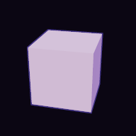

# Render API: `omuzaki-render-api` and `omuzaki-render-mock`

**Status:** proposed. **Spec:** v3 §8 runtime model, §9 crate map, §10 budgets, §21 Look, §26 renders, §39.1 rules 1 and 6.
**Prototype it comes from:** the web prototype (not published): its toon materials and outline, `js/puppet/stage.js` (scene, lights, composer, live and quality modes, timings), `parts/head.js` and `parts/face.js` (the painted face).

## In one minute

The renderer is a **small contract with no GPU types in it**. Heavy data (meshes, textures, materials, render targets) is uploaded once and referenced by `Copy` handles. Each frame the stage fills a plain `Scene` value and calls `render`, which runs a **fixed frame graph** of eight passes and returns a `FrameReport` of per-pass timings for the frame-budget scheduler. Headless rendering to RGBA is the same call with a throwaway target, so goldens, thumbnails and the live viewport share one code path.

```text
   once                              every frame (spec §8: ... → face paint → render → outputs)
   ────                              ──────────────────────────────────────────────────────────
   create_mesh / create_texture      paint_texture(face_atlas, painter)    only when the face changed
   create_material / create_target   scene.clear(); fill instances, lights, joints, camera, post
   release(..) when done             render(target, &scene, &quality)  ->  FrameReport (timings)
                                     read_target(target)               ->  Image   (tests, goldens)
```

Two new crates carry it, plus two shared types that now live in `omuzaki-core`:

| Crate | Kind | What |
|---|---|---|
| `omuzaki-core` | API | `colour` (`Colour`, the sRGB functions) and `mesh` (`MeshData`, `ExtraAttribute`): the types the character kit, I/O and the renderer all exchange. Re-exported by render-api. |
| `omuzaki-render-api` | API | the types, the `Renderer` trait, `RendererExt` (`render_image`, `update_texture`), `Painter`/`PaintTarget`. Depends on `omuzaki-core` only. |
| `omuzaki-render-mock` | Mock | `MockRenderer`: a deterministic CPU rasteriser; `shapes` (cube, quad); and `conformance`, the checks **every** renderer must pass. |



*The mock's cube (`tests/golden/cube.png`, 192x192, committed and compared in a test). The shade side is a tinted multiplier, the outline an inverted hull in a darker colour.*

## Decisions and why

| # | Decision | Why | Rejected |
|---|---|---|---|
| D1 | **Resources retained, scene immediate.** Meshes, textures, materials and targets are created once; the `Scene` is rebuilt every frame. | A frame is a pure function of its inputs (principle 4), so renders replay exactly. The runtime's entities already hold poses, lights and cameras, so a second scene graph in the renderer would only drift. `Scene::clear()` keeps capacity: rebuilding allocates nothing (proved by `tests/hot_loop.rs`). | A retained scene graph in the renderer (hidden state, sync bugs). |
| D2 | **A fixed, linear frame graph** of eight named passes (`Pass::ALL`). | Reproducible, easy for the scheduler to reason about per pass, identical across GPU, mock and web. Implementations may fuse passes if the observable order and per-pass reports hold. | A programmable render graph (flexibility nobody needs, determinism nobody can test). |
| D3 | **Handles are `Copy`, generation-checked, released explicitly.** | Scenes hold handles and are rebuilt every frame; RAII guards would put reference counting in that loop. A stale handle is `UnknownHandle`, never a reused slot. Leaks are caught by `stats()` in tests. | RAII handles; raw ids with no generation. |
| D4 | **Materials are resources with `update_material`.** | A palette swap or a repointed overlay changes a few uniforms, not a re-upload; instances stay a cheap list of ids. | Inline materials in every instance (diffing every frame). |
| D5 | **Parameter types serialise; run-time types don't.** `Colour`, `Toon`, `Outline`, `Mapping`, `Light`, `Post`, `Quality` are `serde` + JSON Schema; `Material`, `Instance`, `Scene` hold handles and don't. | Parameters go in the project document and ops (LK-01..05); handles only mean something to one renderer. The stage builds a `Material` from document parameters plus the textures it uploaded. | One type for both (handles leaking into project files). |
| D6 | **Quality is separate from look.** `Post` is what the author asks for; `Quality` is the cost. | The scheduler degrades by turning `Quality` knobs down and never touches lights, materials or the grade. | Effects toggled inside the look. |
| D7 | **`QualityMode::Offline` is frame-exact.** Output depends only on resources, scene and quality: no history, no wall time; grain and jitter derive from `Scene::frame.index`. | SH-05 and goldens need it. `Live` may reuse work (shadow maps every n-th frame). | Determinism "as best effort". |
| D8 | **The face is an `Overlay` on a material.** A texture composited over the base colour *before* lighting, mapped by UV or by `Planar` projection. | It is exactly what `head.js` does (a canvas projected onto the head), keeps the painted face shaded like the skin, and lets brows appear over the hair with a second overlay. | A special "face" slot (one use case baked into the contract). |
| D9 | **Painters are pulled by the renderer's caller, with a zero-copy escape hatch.** `paint_texture(id, &mut dyn Painter)`; the painter gets a `PaintTarget` with a portable `write_rgba` and a `native()` for GPU painters. | Matches the §8 order (`face paint → render`), needs no registration or ownership inversion, and keeps wgpu out of the API. See *GPU interop*. | Painter registered inside the renderer; wgpu types in the API. |
| D10 | **Light units follow three.js.** A white directional light of intensity 1 gives `albedo / π` on a surface facing it. A point light's `range` is three.js `distance` with decay 2: its colour is scaled by `1/max(d², 0.01) × saturate(1 − (d/range)⁴)²` (`getDistanceAttenuation`). | The prototype's rigs (key 2.0, hemisphere 0.9, ...) port number for number, and the Rust renderer can be compared with the JS goldens (G-JS). | "Intensity 1 = full albedo" (every rig would need re-tuning). |
| D11 | **`Colour` is sRGB8 with alpha, written `#rrggbb[aa]`, and lives in `omuzaki-core`** with the sRGB functions; `MeshData` lives there too. `to_linear()` is the one conversion. | Readable, diffable palettes (LK-03); the same colour everywhere. The character kit, I/O and the renderer need these types without depending on each other, so there is one definition and no conversion layer. | Floats in project files; each contract defining its own colour and mesh. |
| D12 | **Conformance lives in the mock crate and the real renderer runs it.** | The mock can't drift from the contract, and "tested on the mock" means something on the GPU. Mutation-checked: 12 deliberate breakages of the mock (no dependency check, ignored winding flip, unsorted blending, skin ignored, no program fallback, and so on) each fail the suite. | Trusting the mock by reading it. |
| D13 | **Looks beyond toon are named shading programs** (`Shading::Program { name, params }`), self-registered inside `omuzaki-render`; meshes carry named `extra` vertex attributes. An unknown program draws as the toon fallback. | Hair strands and the angel ring need custom shading and custom attributes (`hairUV`, `hairInfo`), but the contract must not carry shader code or GPU types. Parameters are a small typed map, so they serialise, have a schema and are editable by ops. The fallback keeps projects rendering on the mock and on older renderers. | A shader-snippet hook like the prototype's (leaks the backend); a new `Shading` variant per look (a contract change for every look). |

## Spot lights, fog and image-based light (LK-08)

The contract side landed; the mock implements it as the reference. `omuzaki-render` draws `Light::Spot` and `Scene::fog`: a spot is a point light times the cone in the toon lighting, so it goes through the same ramp, and fog fades lit surfaces, unlit surfaces and outlines in linear light as the Opaque, Transparent and Outlines passes write them, before post. Spot shadows are not drawn yet (`casts_shadow` is only the author's wish). It also implements environments: nine-harmonic irradiance and a prefiltered specular cube baked at `create_environment`, and `Scene::environment` through group 3 of the lit passes. Every LK-08 check (spot, fog, environments and the validation of their parameters) is in `conformance::CHECKS`, which the GPU suite requires.

| Piece | Contract |
|---|---|
| `Light::Spot { position, direction, colour, intensity, range, cone_outer_deg, penumbra, casts_shadow }` | D10's distance falloff times three.js's cone: `smoothstep(cos(outer), cos(outer * (1 - penumbra)), cos(angle off the axis))`. `penumbra` 0 is a hard edge at `cone_outer_deg` (`0 < outer <= 90`). It counts toward `MAX_LIGHTS`. `casts_shadow` is the author's wish; spot shadows are the renderer's to add. |
| `Scene::fog: Option<Fog { colour, near, far }>` | Linear in the depth along the view direction (three.js `Fog`, not the distance to the eye): `Fog::amount(depth) = clamp((depth - near) / (far - near), 0, 1)`. Surfaces and outlines blend toward `colour` in linear light before exposure and tone mapping; the background is not fogged. `0 <= near < far`. |
| `Renderer::create_environment(&EnvironmentDesc) -> EnvironmentId` | A resource like a texture (generation-checked, released with `ResourceRef::Environment`, counted in `ResourceStats::environments`). `EnvironmentDesc::Sky { zenith, horizon, ground }` is procedural (`sky_radiance`: the horizon colour blends linearly in height to the zenith above and the ground below); `EnvironmentDesc::Hdri { size, rgb }` is equirectangular linear RGB in the three.js layout (`u = atan2(z, x) / 2π + 0.5`, rows top to bottom). The renderer derives diffuse irradiance and the prefiltered specular chain at creation. |
| `Scene::environment: Option<EnvironmentUse { id, intensity, rotation_deg, toon_ramp }>` | Diffuse light is the sky's cosine-weighted irradiance over π, times `intensity`: a uniform sky of colour `c` lights a diffuse surface to `albedo * c` (three.js `envMapIntensity`). `rotation_deg` turns the sky about +Y, counter-clockwise from above. With `toon_ramp`, a surface takes the irradiance facing the sky's brightest direction (the luminance-weighted mean direction; a uniform sky has none and shades flat) where it faces that way and the irradiance facing away elsewhere, blended by the material's ramp (`shift`, `softness`) over the dot of normal and brightest direction, so the sky lights in the cel bands. The environment must be live at `render` (`UnknownHandle` otherwise). |

The toon materials of v1 have no specular term, so the prefiltered specular chain has no consumer yet; it is part of what `create_environment` builds so materials with a specular term (LK-07's matcap, programs) need no contract change. `Scene::clear()` leaves `fog` and `environment` as they are, like `background`; both are `Copy` values, so refilling a scene allocates nothing more than before.

## The frame graph

`Pass::ALL` is the order. A pass with nothing to do reports `None` (distinct from "ran in zero time").

| # | Pass | Does | Skipped when |
|---|---|---|---|
| 1 | `PaintTextures` | painters fill dynamic textures (face atlas, brow layer) | no `paint_texture` since the last frame |
| 2 | `Shadows` | the shadow map of the first casting directional light; the renderer fits the frustum to the casters (see below) | shadows off, no caster, or `Live` between `shadow_interval` redraws |
| 3 | `Opaque` | opaque and alpha-mask instances: toon shading into colour and depth | never |
| 4 | `Outlines` | inverted-hull outlines, back faces only, after the model so they hide behind it; a material's alpha mask cuts its hull where it cuts the surface (three-vrm's `MToon` outline), so a cut-out card is outlined along its visible shape | no material has an outline |
| 5 | `Particles` | stateless particles evaluated in the vertex stage, two instanced draws per block of batches: colour with alpha-to-coverage and depth, then alpha (particles.md D4 to D6) | no spawn batch |
| 6 | `Transparent` | blended instances, `order` then back to front, depth-tested, not writing depth | none blended |
| 7 | `Bloom` | glow from bright areas | off in `Post`, `post_effects.bloom` false, or unsupported |
| 8 | `DepthOfField` | blur away from the focus distance | off in `Post`, `post_effects.depth_of_field` false, or unsupported |
| 9 | `Resolve` | sample resolve, exposure, tone map, grade, grain, output transform to the target's alpha encoding | never |

## Quality: live, high, offline

`Quality { mode, render_scale, samples, shadows, shadow_interval, post_effects, particle_density }`, with presets:

| Preset | Mode | Scale | Samples | Shadows | Interval | Post | For |
|---|---|---|---|---|---|---|---|
| `live()` | Live | 1.0 | 4 | Low | 2 | none | streaming, viewport (budget 1.5 ms GPU) |
| `high()` | Live | 1.5 | 4 | High | 1 | all | the editor's quality mode (budget 4 ms) |
| `offline()` | Offline | 1.0 | 16 | High | 1 | all | SH-05 renders, goldens, thumbnails |

`post_effects` is a `PostQuality`, one switch per effect (`bloom`, `depth_of_field`, `grain_and_grade`), because they differ ten-fold in cost (#657); `true` or `false` in JSON still means all or none.

The preset numbers are placeholders until the toon spike measures them. Prototype equivalents: live = pixel ratio 1, no bloom, shadow map every second frame; quality = bloom, soft shadows every frame.

**Shadow maps (R2c).** The first directional light with `casts_shadow` owns one depth map per render target. `Low` is 1024 texels, `High` 2048, both looked up with a 3 x 3 grid of bilinear comparisons (`Low` one texel apart, `High` two, so the edge is the same width in metres at twice the resolution); `Low` reproduces three.js's `PCFSoftShadowMap` at the prototype's 1024 map. The frustum is fitted to the casters' world bounds (skinned instances through per-joint boxes) and reaches the farthest shadow receiver: a square window around the casters' bounding sphere, its radius stepped up a geometric ladder (four steps per octave) and its centre snapped to the texel grid, so a drifting or posing character does not shimmer; the camera plays no part. Single-sided surfaces draw their back faces into the map (as three.js does), masked and blended ones discard like the lit pass, and the lookup offsets the point by 1 cm along the normal and the depth by 2.4 mm (the prototype's `normalBias` 0.01 and `bias` -0.0004). `receives_shadows = false` materials ignore the map. In `Live` mode the map is redrawn every `shadow_interval`-th frame (the first frame, a turned light and a new map size redraw at once) and the frames between report `Shadows` as `None` and sample the last map; `Offline` redraws every frame. The `shadow` block of a light rig (`omuzaki-stage`) is not part of the contract: its map size, frustum bounds and biases are the prototype's numbers kept for comparison, and the renderer's fit and constants replace them.

The degrade ladder (`omuzaki-budget`, `Step::LADDER`): depth of field, bloom, `render_scale` to 0.75, `shadow_interval`, `Shadows::Low`, `render_scale` to 0.5, `Shadows::Off`, `samples`, and grain and grade last; the face system independently shrinks the face atlas.

## Materials: prototype to contract

| Prototype | Contract |
|---|---|
| `toon({ color, shade, shift, soft, rim, rimPower, rimStrength, emissive })` | `Material.base` + `Shading::Toon(Toon { shade, shift, softness, rim: Rim, emissive, skin })`; defaults are the prototype's |
| `SKIN_FLOOR`, `SKIN_OUT` (keep hue, lift shadow floor) | `Toon.skin: Option<Skin { floor, hue_keep }>` |
| `side: DoubleSide`, `transparent`, `alphaTest`, `vertexColors` | `double_sided`, `AlphaMode::{Opaque, Mask, Blend}`, `vertex_colours` |
| `outline(mesh, { color, width })`, `OUTLINE_LIGHT` | `Material.outline: Outline { colour, width }` (metres at 2 m, scaled by `clamp(d/2, 0.6, 3)` in one shared `world_width`), `Scene.outline_light`; `Material.outline_style: OutlineStyle { width_mode, width_texture, lighting_mix }` keeps that as `OutlineStyle::KIT` and adds MToon's constant-metre (`World`) and screen-height (`Screen`, a fraction of the target height) widths, a width texture (green channel, per vertex) and the lighting mix (#647) |
| head `fragDiffuse` projects the face canvas by local XY | `Overlay { texture, mapping: Mapping::Planar { min, max, fade_from, fade_to }, strength }` |
| hair `uBrow` brows through the bangs | a second `Overlay` on the hair material, same rect, hard cut at `z > 0`, strength 0.85 |
| `castShadow` / `receiveShadow` | `Instance.casts_shadow`, `Material.receives_shadows`, `Light::Directional.casts_shadow` |
| stage lights (hemisphere, key, rim, fill) | `Light::{Hemisphere, Directional, Point}` |
| `EffectComposer`: `RenderPass`, `UnrealBloomPass`, `OutputPass` (ACES) | passes 3 to 8 and `Post { exposure, tonemap, bloom, depth_of_field, grain, grade }` |
| `setLive`, `pixelRatio` | `Quality` |
| `stage.timing`, `renderer.info.render.calls/triangles` | `FrameReport` |
| skinned meshes bound to a skeleton | `Instance.skin` + `Scene.joints` (final skinning matrices; `omuzaki-rig` owns the skeleton) |
| backdrop (`desk.js`) | instances with `Shading::Unlit` |
| hair strand and angel-ring GLSL, `hairUV` and `hairInfo` attributes | `Shading::Program { name: "hair", params }` plus `MeshData.extra` (`hair-uv` 2 floats, `hair-info` 3 floats); the program itself is written in `omuzaki-render` (stream S6) |

## Face painter compositing

The face is painted by `omuzaki-face` into a **dynamic texture owned by the renderer**, and a material **overlays** it. Per character, once:

1. `create_texture(TextureDesc { size, colour_space: Srgb, alpha: Premultiplied, mips: true, usage: Dynamic, sampler: aniso 8 })` for the face atlas, and a smaller one for brows (the prototype uses 1536 px and 768 px wide).
2. The head material gets `overlays = [Overlay { face_atlas, Planar { rect = face rectangle, fade 0..0.07 }, 1.0 }]` and `receives_shadows = false`; the hair material gets the brow overlay.

Every frame, in spec §8 order: the face system decides whether the picture changed (the prototype redraws only then); if so `renderer.paint_texture(face_atlas, &mut painter)`; the stage then builds the `Scene` and calls `render`. Contents persist between frames, so an unchanged face costs nothing. A painter that fails leaves the old pixels. The face's GPU time shows up under `Pass::PaintTextures` in the next frame's report (budget `budget::FACE_PAINT_GPU`, 0.5 ms).

To lower the atlas resolution under load: create a smaller texture, `update_material` to repoint the overlay, release the old texture (the renderer refuses to release it while a material still reads it, which is the order that is always safe).

**GPU interop.** `PaintTarget::write_rgba` works everywhere (CPU painters, tests, the mock). The ≤ 0.5 ms budget needs the painter to draw on the GPU directly, so `PaintTarget::native()` returns `&mut dyn Any`. Convention (Q1, revised by #2074): the wgpu renderer's `native()` is `omuzaki_render::NativePaintTarget`, a `(wgpu::Device, wgpu::Queue, wgpu::Texture, wgpu::CommandEncoder)`. The first three are cheap `Clone` handles; the texture is the one painters write (`Rgba8Unorm`, `STORAGE_BINDING | RENDER_ATTACHMENT | COPY_DST`, level 0 only). The encoder is the renderer's: a GPU painter downcasts, records its passes into it and may write its own buffers through the queue, but never submits. When the painter returns `Ok`, the renderer submits the encoder inside the paint's error scope, between two GPU timestamps that count towards `Pass::PaintTextures` (so `gpu.face_paint` is the renderer's own measurement, not the painter's); when it fails, the encoder is dropped unsubmitted and the texture keeps its old pixels. A painter that doesn't recognise the handle falls back to `write_rgba`. `PaintTarget::mark_damage(rect)` (default: ignored) lets a native painter say what it changed: without it the whole texture counts as changed, and the `PaintTextures` pass rebuilds the mips over the reported rectangle only. Queue submission order makes the paint happen before the next `render`. No wgpu type appears in either API crate; `omuzaki-render` and `omuzaki-face` both depend on the pinned `wgpu` (an external crate, which the dependency rule allows) and share the convention, which `crates/omuzaki-test-stage/tests/face_gpu_interop.rs` checks (#151): a drift sends the face to the CPU raster, and the test fails.

Why the encoder (#2074): the face's GPU work is small (0.1 to 0.2 ms on the development PC's GPU), and what it cost was the CPU around it. `vello::Renderer` rebuilt its GPU side and submitted on every repaint (0.77 ms of CPU and 816 allocations per repaint), and the old probe's timestamps, in separate submissions, measured the GPU waiting on that CPU (5.8 ms). The face now runs Vello's stages on resources kept between repaints and records them into the renderer's encoder, and the renderer times them.

## Shading programs: the registration contract

`Shading::Program { name: Slug, params: ProgramParams }` selects a named program; `ProgramParams` is a `BTreeMap<Slug, ParamValue>` with `ParamValue::{Float, Vec2, Vec3, Colour, Bool}` (at most 32; serde and JSON Schema, so they live in the document and ops can set them). The program still receives the material's `base`, `base_texture`, `overlays`, `alpha` and `outline`, and adds its own shading from `params` and the mesh's `extra` attributes. Programs are **not** in the API crate; this is the contract that lets them be added without touching it:

1. **One file per program**, in `omuzaki-render` (for example `crates/omuzaki-render/src/programs/hair.rs`), registered with a `register_shading_program!` macro over `inventory`, as ops are (§39 rule 2). Nothing edits a central list or enum. The macro is part of the future `omuzaki-render` crate, not of this contract.
2. A registration declares: the program's `Slug` **name** (unique; a duplicate fails renderer creation with `RenderError::Backend`); its **parameters** (name, default `ParamValue`, optional range); the **extra vertex attributes** it reads (name and components, 1 to 4); and its shader code (the renderer's own concern).
3. `create_material` and `update_material` **validate `params` against the declaration**: an unknown name, a wrong type or an out-of-range value is `Invalid`; a missing parameter takes its default.
4. **A mesh lacking an attribute the program reads supplies zeros**, so meshes built before a program gained an attribute still draw.
5. **An unknown program name is not an error.** The material is drawn as `Toon::default()` over the same base, textures and overlays, so a project keeps rendering on the mock (which knows no programs) or on an older renderer. `Capabilities::shading_programs` lists the names a renderer knows, so ops and the UI can say "this look needs the hair program".
6. `MeshData.extra` is `Vec<ExtraAttribute { name, components, data }>`: at most 4 per mesh, distinct names, `components` floats per vertex. `MeshData::validate` (in `omuzaki-core`) checks the shape; an attribute no program reads is ignored.

The mock implements 5 and nothing else, and `conformance` checks it (an unknown program plus a mesh with an extra attribute must render exactly as a plain toon material).

### In `omuzaki-render`

The registry is `crates/omuzaki-render/src/program/`; `program/mod.rs` documents how to add a program (one file, one `mod` line). What the implementation fixes beyond the contract above:

- **Packing.** A material's parameters are packed tightly, in declaration order, into the uniform's `program[]` (64 floats; colours in linear light). The shader gets each parameter's float offset as a generated constant (`P_RING_STRENGTH`), so declaration and shader cannot drift.
- **Hooks.** A program's WGSL defines `program_albedo` (the surface colour before lighting) and `program_light` (the lit colour after the toon model), and optionally `program_alpha(p: ProgramIn, alpha: f32) -> f32`: the alpha of a blended fragment, identity when the program does not define it. Only `fs_blend` (the Transparent pass) calls it, so the Opaque path is unchanged. `ProgramIn.world_position` is the fragment's world position (metres), for lookups such as `shadow_visibility`. Blended receivers count when the shadow map is fitted, so a blended ground receives shadow. The toon terminator, lights, rim, skin, base texture, overlays, alpha and outline stay the renderer's. The program supplies its own toon base (`ProgramSpec::toon`, a function of the resolved parameters), because `Shading::Program` carries no toon fields.
- **Attributes.** Up to four extra streams are bound to vertex buffer slots 1 to 4 (shader locations 6 to 9) and reach the hooks as `ProgramIn.extra[i]`. A missing attribute, or one with another component count than declared, is a stride-0 stream over one 16-byte zero buffer, so it needs no per-mesh allocation. The pipeline is keyed by program and by which attributes the mesh has.
- **Unknown names.** Contract rule 5 stands: the material draws as toon. The diagnosis is available from `omuzaki_render::check_shading_program(name)`, which returns an `UnknownProgram` with did-you-mean suggestions and the known names; ops and the UI call it where they want to warn.
- **Blended materials.** The `Transparent` pass reuses `toon_colour` and the program hooks (`program_albedo`, `program_light`), so a program material with `AlphaMode::Blend` is shaded like the opaque one and blended. Order is per instance (`Instance::order`, then the distance of the instance's box centre, farthest first, then scene order); triangles of one instance are not sorted against each other.
- **The `hair` program.** Parameters `root`, `mid`, `tip`, `shade`, `line`, `ring`, `ring-strength`, `ring-width`, `ring-wobble`, `ring-teeth`, `ring-follow`, `ring-shift`, `strand-lines`, `edge-darkening`, `keep-identity`; attributes `hair-uv` and `hair-info`; defaults are `HairShading::default()`'s. The hooks are a line-for-line port of the prototype's `parts/hair.js`; the ring's half width, wander and comb teeth are parameters (#2462), and `ring-follow` turns the painted ring into a lobe along each lock's own direction (the gradient of `hair-uv.y` from the screen-space derivatives every program now gets in `ProgramIn`), lit from the eye's level direction and slid up or down the head by `ring-shift` (#2483), and the kit's defaults draw a thin, steady arc where the prototype's 0.11, 0.06 and 1 draw a soft band stepping from lock to lock (the oracle test sets those). A shade of exactly 0 in `hair-info` (a mesh that lacks it) reads as 1, so such a mesh is not black. Not in the program, by design: the brows through the bangs are a second `Overlay` on the hair material (`HairShading.brows_through`); `outline_width` goes on the material's `Outline`; `streaks` and `inner_darkening` are applied on the CPU by the character kit (vertex colours and `hair-info` shade), so the program's parameters do not change.
- **Mesh conventions the ring depends on.** The third float of `hair-info` is the polar angle **from the top** (+Y) of the direction from the head centre, in radians (the prototype's `acos(dir.y)`; the ring sits at 0.92), and the ribbons must be counter-clockwise seen from outside: the shader lights the back of a double-sided surface with a flipped normal, so a ribbon wound the other way sees the ring's `N.V` inward and loses it. `omuzaki-char-mock` follows both (pinned by tests).
- **Program table.** Each program has rustdoc with the formula (`crates/omuzaki-render/src/program/<name>.rs`). Parameters are checked at `create_material` and `update_material` against the ranges below.

  | Program | Parameters (default) | Effect |
  |---|---|---|
  | `sheen` | `colour` (`0x453a38`, linear `0.060, 0.042, 0.040`), `edge0` (0.62), `edge1` (0.96), both `0..=1` | adds `colour x smoothstep(edge0, edge1, dot(N, V))` to the lit colour; exactly `colour` where the surface faces the eye. From the prototype's tights (`body.js` 169) |
  | `band-highlight` | `dir` (`-0.32, 0.58, 0.75`, components `-1..=1`, normalised by the shader), `colour` (`0xfff2c8`), `edge0` (0.86), `edge1` (0.90), `strength` (0.6), all three `0..=1` | `lit = mix(lit, colour, smoothstep(edge0, edge1, dot(N, dir)) x strength)`. From the boots and gold (`boots.js` 297-306, `uniform.js` 450) |
  | `shadow-catcher` | `opacity` (0.25, `0..=1`) | black, `alpha = opacity x (1 - shadow_visibility(world_position, +Y))`: invisible where lit, `opacity` black in full shadow. Needs `AlphaMode::Blend`, a receiving material and an instance with `casts_shadow = false` (a casting ground would widen the shadow fit). The stage ground disc: radius 0.8, 48 segments, 0.25 |

  **View-space semantics of `band-highlight`.** `N` is the normal in the camera's frame (x right, y up, z toward the viewer) and `dir` is a direction in that frame, so the highlight is fixed on screen: it rides with the camera and does not move when the character, the lights or the camera turn (the prototype's `normal` is three.js's view-space normal). A zero `dir` draws no highlight. The hooks receive a world-space normal; the program rotates it by the frame's view matrix itself. For both programs `edge1` should exceed `edge0`; otherwise the ramp is a hard step at `edge0`.

## GPU resource lifetimes

Written out on `Renderer` in the API docs; in short:

- **Creation is immediate.** A new handle works on the next call; uploads are ordered before later draws.
- **Release is deferred, handles die at once.** The handle is invalid straight away (`UnknownHandle`; a double release is an error); GPU memory goes when no frame in flight uses it. `stats()` counts drop immediately, `gpu_bytes` may lag.
- **Dependencies are checked at release.** A texture a live material reads gives `InUse`. Scenes are values, so a scene naming a released mesh or material fails at `render`.
- **Device loss is terminal.** `DeviceLost`: build a new renderer and upload again from the CPU copies (the store, the painter state). That is why the API only returns GPU data through `read_target`.
- **One thread, `&mut self`.** The render thread owns the renderer (spec §8). `Renderer: Send`.
- **Creation limits** are guarantees (`limits`): 8 lights, 2048 joints, 4 overlays, textures up to 4096 on every renderer; `Capabilities` reports more.

## The rendered frame: one texture for the viewport and the outputs (#629)

The stage renders into a target; the studio's viewport and every live output (virtual camera, capture window, Spout,
NDI, recording) read that one frame. The contract between them is `Renderer::target_native(target)`:

| Who | How it gets the frame |
|---|---|
| The UI viewport (`omuzaki-ui`) | creates the renderer on eframe's device (`WgpuRenderer::from_device`), so the target lives on the device egui draws with; `target_native` gives the texture, which `egui_wgpu::Renderer::register_native_texture` shows with no copy. After a `resize_target` it registers the new texture. |
| A GPU output (`omuzaki-stream`) | downcasts `target_native`'s `&dyn Any` to `(wgpu::Device, wgpu::Queue, wgpu::Texture)` (exported as `omuzaki_render::NativeTarget`, the form `omuzaki-stream-api`'s `Frame::gpu` names) and copies or shares the texture on its own thread's schedule, so the render thread never waits for an output. |
| A CPU output, or a renderer without a GPU (the mock) | `read_target`, which waits for the GPU; `target_native` is `None` on the mock. |

The texture is `Rgba8Unorm` holding sRGB-encoded bytes in the target's `AlphaEncoding` (`Straight` for a viewport and
PNGs, `Premultiplied` for outputs that composite), at the target's size, usable for sampling and as a copy source.
The next `render` into the target draws into the same texture: a consumer samples or copies it before then, and a copy
submitted after one `render` sees that frame by queue order. Its timing is the `FrameReport` that `render` returned
(the stage's `FrameOutput::report`), with the frame's index and time in `FrameReport::frame`.

The stage side is `omuzaki-stage`'s `FrameLoop` (implemented by the kit's `Stage`, the imported `AvatarStage`, and
`AnyStage`, which holds either): one `tick` per frame renders into the stage's target, so every consumer above reads
the same frame whatever body is on stage.

## Headless rendering, the mock and goldens

`render_image(size, alpha, &scene, &quality) -> Image` is create target, render, read back, release. `Image` is RGBA8, sRGB-encoded colour, rows top to bottom, with an explicit `AlphaEncoding` (`Straight` for PNGs and the viewport, `Premultiplied` for compositing on the GPU). Premultiplied means the stored numbers are multiplied by alpha. Outputs do not all want the same encoding, so the stream layer converts per output (#629): NDI documents its BGRA and RGBA as straight (un-premultiply on the GPU in float before quantising); Spout carries no alpha flag and OBS's Spout2 source composites by a per-source mode the person sets (a premultiplied frame blended as straight leaves a dark halo, a straight one blended as premultiplied a bright fringe); a virtual camera has no alpha at all (flatten over a background or key colour).

The mock draws with an exact integer rasteriser (1/256-pixel snapping and 64-bit edge tests, so shared edges never gap or double-hit), perspective-correct attributes, the toon ramp with tinted shade, rim, skin treatment, overlays, hull outlines, blending with sorting, exposure, ACES, and integer supersampling. It shades flat per triangle and has no shadows, bloom, depth of field, grain or grade; `Capabilities.passes` says so and `FrameReport` shows those passes absent. It never reads a clock: `set_pass_cost` makes it report chosen timings so scheduler tests can simulate an over-budget frame.

Determinism: identical bytes run to run on one platform and toolchain. Across platforms the only drift is the last bit of `powf` in the sRGB curve, so cross-machine compares use a tolerance of 2 levels (the cube golden test does). GPU renderers promise equality only within a rounding step (`Capabilities.bit_exact` is false), so GPU goldens compare with a tolerance stated per scene.

`conformance::run_all(&mut renderer)` runs 14 checks (stale handles, dependency-checked release, stats, invalid input, report shape, offline history independence, background and alpha encoding, painted overlays including a failing painter, outlines and `outline_light`, blend sorting, skinning, mirrored transforms, sample smoothing, the fallback for unknown shading programs). `omuzaki-render` runs the same call in its tests.

**Evidence** (all in this change): 27 unit tests in the API, 21 in the mock, and 10 for the colour and mesh types in `omuzaki-core`; 2 conformance tests; 5 cube tests (matches the golden PNG, PNG round trip is byte for byte, two renders are identical, a one-sample frame has exactly five flat colours, the cube stands out from the backdrop); a doctest; and `tests/hot_loop.rs`, which uses a counting allocator to show 100 frames of scene rebuild and validate make zero allocations. Benchmark, `cargo bench -p omuzaki-render-api --bench scene`: validating a scene of 200 instances, 128 joints and 8 lights takes about 1 µs, clear and refill about 1 µs (under 0.1% of the 1.5 ms budget).

## Timings for the scheduler

`FrameReport` is `Copy` with no heap data: `frame`, `render_size` (after `render_scale` and supersampling), `cpu: PassTimes`, `gpu: Option<GpuTimings>`, `draw_calls`, `triangles`. GPU timestamps resolve a frame or two late, so `GpuTimings.frame` names the newest finished frame (the prototype's `gpuPoll` EMA does the same). `PassTimes` distinguishes "did not run" (`None`) from "ran, took 0". The §10 budgets are constants in `budget`. Smoothing (the EMA) belongs to the scheduler, not here.

## Interfaces with other contracts

These are proposals for the maintainers to reconcile; nothing here depends on the other crates.

- **`omuzaki-face-api` / `omuzaki-face`.** The face painter implements `Painter` and draws into the `PaintTarget` it is handed (portable `write_rgba`, optional GPU `native()`). The face-api owns the face parameters and the painter's own state; render-api knows nothing about eyes or mouths. The face layout rectangle (today `HEAD.FACE`) is the `Planar` mapping the char kit puts on the head material. The face-api should decide whether atlas size is a face parameter (it is the thing the scheduler shrinks).
- **`omuzaki-char-api` / `omuzaki-char`.** Parts build `MeshData` (from `omuzaki-core`: positions, normals, UVs, vertex colours, 4 joints and weights, named extra attributes, triangle list) and `Material` parameters (`Toon`, `Outline`, overlays). `Colour` (also `omuzaki-core`) is the palette type (LK-03). The stage assembles `Instance`s. Ids like `CharId` stay in char-api.
- **`omuzaki-anim-api` / `omuzaki-rig`.** The rig produces final skinning matrices (`joint_pose * inverse_bind`, bind space to model space) and writes them into `Scene.joints`; `Instance.skin` is a range into it. The renderer needs no skeleton, no bone names. Camera and light tracks (SH-02, SH-10) fill `Camera` (`look_at`, `Projection`) and `Light`s, and `Post` for DoF focus. `Scene.frame { index, time }` comes from the timeline: `time` is the timeline position; on the live path `index` is a per-submission counter, at least one higher than the last submission's, because it identifies the submission in `FrameReport::frame` and `GpuTimings::frame` for the frame-budget scheduler (`omuzaki-budget`; a timeline index repeats while paused and jumps back on a loop, so a cached GPU result could not be told from a fresh one, and grain would freeze). Offline and export renders are not observed and may repeat an index on purpose to re-render a frame exactly.
- **`omuzaki-io-api` / `omuzaki-io`.** Importers produce `MeshData`, texture pixels with a `TextureDesc`, and `Material` (MToon maps onto `Toon`: `shadeColorFactor` to `shade`, `shadingShiftFactor` to `shift`, `parametricRim*` to `Rim`). Exporters read the same types. PNG encode and decode of `Image` live in `omuzaki-io`, not here.
- **Ops (`omuzaki-ops-api`).** `render.preview`, `turnaround`, `contact_sheet`, `compare` and `golden.check` (spec §11) call `RendererExt::render_image`. The look parameters (`Toon`, `Light`, `Post`, `Quality`) are the op argument types, which is why they carry JSON Schemas.
- **`omuzaki-stream-api`.** Live outputs share the target's GPU texture through `target_native` (Spout, Syphon, NDI, virtual camera; see *The rendered frame*); the CPU path is `read_target`. The target's `AlphaEncoding` is the output's.
- **Goldens (`omuzaki-test`).** The harness calls `render_image` with `Quality::offline()`, compares with a tolerance, and can run the mock where no GPU exists.

## Dynamic meshes and morph targets

One additive change, so the hub crate rebuilds once. Existing callers compile unchanged apart from `Instance` and `Capabilities` struct literals.

**The API.**

| Item | Meaning |
|---|---|
| `MeshUsage { Static (default), Dynamic }`, `MeshOptions { usage, morphs: Option<MorphSet> }` | what a mesh is created with |
| `Renderer::create_mesh_with(mesh, options)` | default method: default options forward to `create_mesh`, anything else is `Unsupported` |
| `Renderer::update_vertices(mesh, positions, normals)` | default method (`Unsupported`); `Invalid` for a `Static` mesh, a count mismatch or a non-finite value |
| `MorphSet`, `SparseMorph { name, indices, positions, normals }` | sparse targets: only the vertices a target moves, indices strictly ascending |
| `MorphSet::from_dense(vertex_count, &[(name, positions, normals)], epsilon)` | converts `omuzaki-io-api`'s dense `MorphTarget` layout, dropping vertices whose position and normal deltas are both `<= epsilon` long |
| `Instance::morph: Option<MorphRange>`, `Scene::morph_weights` | a range into one flat finite `f32` buffer (at most `limits::MAX_MORPH_WEIGHTS` = 4096), like `skin` and `joints`; cleared by `Scene::clear()` |
| `Capabilities::{dynamic_meshes, morph_targets, max_morph_targets}` | what to check before using them; false/0 means `Unsupported` |

**The math (the mock is the oracle).** Per vertex, in `f32`, in target order: `position = base + Σ wᵢ·Δpᵢ`, `normal = normalize(base_normal + Σ wᵢ·Δnᵢ)`; **then** skinning, then `Instance::transform`, as in glTF. Weights are not clamped (glTF allows any real value, negative included) but must be finite. A zero weight contributes nothing, so all-zero weights (or `morph: None`) draw the base mesh exactly. A vertex no normal delta reaches keeps its normal; a blended normal that cancels to zero keeps the base normal. `omuzaki_render_mock::morph_vertices` is that formula as a public function, the reference R3 (CPU blend) and R4 (GPU compute) are checked against.

**Rules.** `Instance::morph.len` must equal the mesh's target count; `Scene::validate` checks the range and weights, the renderer checks the count against the mesh (`Invalid` at `render`, also for weights on a mesh with no targets). `update_vertices` keeps topology, UVs, colours, skinning data and morph targets; morphs and skinning apply on top of the new vertices. The mock's outline hull uses the welded base normal shifted by the morph's normal change, so welded seams stay closed.

**Also in this change (ported; EX-12, `docs/design/byom.md` D3 and D7).** `Material::uv_transform` (`UvTransform { scale, offset }`, `IDENTITY` default, finite-checked) applies `uv x scale + offset` to the UV of every UV-addressed texture: the base texture and `Mapping::Uv` overlays, not planar overlays; `UvTransform::apply` is the single definition and the mock samples through it. `Capabilities::mtoon` (`MtoonSupport`, a `u8` bitset with seven group constants, `contains`, `with`) lists which MToon groups a renderer draws; the mock and the wgpu renderer report `NONE`. The conformance check "a UV transform picks the atlas cell" is in `CHECKS`, so it runs on both renderers.

**Conformance.** `conformance::DYNAMIC_CHECKS` and `MORPH_CHECKS` (run by `run_capable`, per claimed capability) are kept out of `CHECKS` so a renderer that does not claim the capability is unaffected: update then render matches a fresh mesh, updating a static mesh is `Invalid`, zero weights match the base, weight 1 adds its delta, two instances of one mesh morph independently, morph then skin matches the hand-computed composition, and bad morph input is rejected. **In `omuzaki-render` (wgpu):** R2 `update_vertices` (a `COPY_DST` vertex buffer, `write_buffer` of the changed range; `Renderer::update_vertices` in `src/renderer.rs`, `GpuMesh::update_vertices` in `src/resource/mesh.rs`), R3 the CPU blend into per-instance shape streams (`src/morph/cpu.rs`), and R4 the GPU compute morph pass (`src/morph/gpu.rs`; target: 52 targets at 20k vertices in 0.1 ms on a desktop GPU), both pooled per instance by `src/morph/mod.rs`.

## Not in v1 (and how it arrives)

Each is additive; only `omuzaki-render` and the mock `match` on the enums involved.

- **The hair program itself** (and any other shading program): the contract is here (`Shading::Program`, `MeshData.extra`); the programs are written in `omuzaki-render` by the features that need them (hair: S6).
- **Screen-space outlines** (second half of LK-02): a new variant on `Outline`. Tracked as a feature, arriving in phase 2 ahead of bring-your-own-model (EX-12), not as a later tier, together with LK-07 (MToon's matcap, GI equalisation, UV animation and render-queue offset, which extend `Toon`).
- **Tiled offline renders above `max_texture_size`:** a loop above this API, using a camera sub-window.
- **A degrade ladder and the scheduler itself:** the frame-budget scheduler is separate work.

## The wgpu implementation (`omuzaki-render`)

The crate docs of `omuzaki-render` are the map (module layout, who edits what); these are the decisions that shape what the contract means on a GPU.

- **Scene colour is linear, premultiplied RGBA16F**, drawn into a multisampled target and resolved in hardware the first time a pass needs the single-sample picture. `Resolve` is the only place exposure, tone mapping (three.js's ACES variant, `exposure / 0.6`, so the prototype's values carry over), the sRGB curve and the target's alpha encoding apply; each tap is tone-mapped before taps are averaged, so bright edges stay clean. The GPU matches the three.js formula within 0.64 level on saturated colours (`tests/render.rs`); the mock's ACES is Narkowicz's per-channel fit and differs from it by 13 levels on greys and up to 204 on saturated colours, so parity tests with the mock set `Tonemap::None`. A target is `Rgba8Unorm` holding sRGB-encoded bytes, so egui or a live output can show it without conversion. *Measured on a desktop GPU (Vulkan, 1080p, 4x MSAA, 130k triangles, GPU timestamps): 0.086 ms for Opaque plus Resolve, 0.348 ms at 4K. An 8-bit scene colour would cost 0.063 ms and 0.209 ms (the 16-bit format is the bandwidth-bound part), and fusing the sample resolve into the geometry pass gained nothing (0.088 ms), so the passes stay separate. `SCENE_FORMAT` in `gpu.rs` is the one constant to change if a mid-range laptop shows the 16-bit target costs too much; 8 bits would lose the headroom above 1.0 that exposure, ACES and bloom use.*
- **`samples` is hardware MSAA.** `Capabilities::max_samples` is the largest count the adapter offers for the scene format (4 on lavapipe, 8 on a desktop GPU); a request for more draws with that maximum. Jittered supersampling for the rest (the offline preset's 16) is not built, and on a desktop GPU a request above 4 fails outright until the renderer enables the adapter-specific format features. `render_scale` above 1 does supersample: `Resolve` averages a grid of taps.
- **Post effects (R2d).** Bloom, depth of field, grain and grade honour `Post` and `Quality::post_effects`, one switch each (all off: `Resolve` is exposure and tone mapping alone, byte for byte what R1 drew).
  - *Where the work is.* `Bloom` and `DepthOfField` draw small images and publish them (`PostProducts` in `frame/attachments.rs`); `Resolve` folds them in per tap while it already holds the scene colour, then applies grade, grain and a one-level triangular dither to the averaged *straight* display colour. No effect re-reads and rewrites the HDR scene image. Both effects work at the **target's** size whatever `render_scale` is: the scheduler lowers `render_scale` and must not change the author's look (D6), and supersampling would otherwise multiply the cost of two low-frequency effects.
  - *Bloom* is three.js's `UnrealBloomPass` stage for stage (high-pass, five blurred mips, weighted composite), so the prototype's numbers carry over. It matches pictures made by the prototype's own composer (three.js 0.170, `tests/golden/`) within 2 levels on lavapipe, and a desktop GPU and lavapipe agree within 1 level. Two three.js details are kept on purpose: the threshold is on linear luminance *before* exposure, and the glow is multiplied by its own alpha, so it grows with the square of `strength`. The dither is what keeps a long fall-off from banding in 8 bits (three.js, at 8 bits without it, shows the contours; `bloom_banding_stretched_falloff.png` in the evidence).
  - *Depth of field* is a thin lens with a flat sharp zone (`focus_range`): a prepass reduces the colour and turns the nearest depth of each block into a signed circle of confusion, a block search finds the widest blurred foreground near each pixel, and a gather averages a golden-angle spiral across a disc. A neighbour in front of a pixel only counts if its own blur reaches it, so a sharp character (outline included) never smears into the blurred background, and a blurred foreground still spreads over a sharp one.
  - *Alpha.* Effects never touch alpha, so a transparent pixel stays (0, 0, 0, 0) in both encodings. Bloom lights the scene in linear light and shows through what the scene does not cover; over a transparent silhouette its alpha is the display brightness of the glow, so a straight and a premultiplied consumer both composite the halo (the two composites agree within 2 levels, and match the opaque render over grey within 15 at the brightest halo pixel and 0.6 on average).
  - *Quality modes.* Live and offline draw the same look. Offline samples more finely (depth of field gathers 6 taps per pixel of radius up to 128, and compares four depth samples, against 1.5 up to 20 and one live) and is frame-exact: grain and dither are integer hashes of the pixel and `FrameInfo::index`, nothing reads history, so a frame re-renders to the same bytes (tested on lavapipe and on a desktop GPU). `Quality::live()` keeps every post effect off. Offline frames reach 16 samples past the hardware's by jittered rounds on a fixed pattern (#653).
  - *Memory.* About 25 MB at a 1080p target with bloom and depth of field on (100 MB at 4K), kept per target size in the passes, not counted in `ResourceStats::gpu_bytes`.
- **Texture storage** follows `crates/omuzaki-render/src/resource/texture.rs`: straight sRGB uses an sRGB format (hardware decode before filtering); premultiplied or linear data is stored raw and the shader divides by alpha and decodes after filtering. Textures are bilinear and mip-mapped (the mock reads the nearest texel, so a parity test asks for hard texels).
- **GPU timings** come from timestamp queries the frame graph writes between passes (one `write_timestamp` before and after each), so a pass may record any number of GPU passes and still gets one duration. They need `TIMESTAMP_QUERY` and `TIMESTAMP_QUERY_INSIDE_ENCODERS`; without them `Capabilities::gpu_timings` is false. Results arrive a frame or two late and never stall the loop. The newest result is the newest *submission*, counted by the renderer; `GpuTimings::frame` is only the caller's label, so a looping or scrubbing timeline (indices going backwards) keeps updating, and for a frame or two after a jump the label still names the pre-jump frame that was measured.
- **Allocation.** The renderer's own code allocates nothing per frame after warm-up (checked by a backtrace-attributing allocator in `tests/hot_loop.rs`). wgpu itself allocates inside its calls (about 20 per submit and 17 per render pass), so the process total is not zero: 114 per frame for a cube, 212 for a busy scene with a repainted face.
- **`FrameReport::draw_calls`** counts every draw, including the `Resolve` triangle.
- **Errors, not panics.** Every GPU-touching call runs inside validation and out-of-memory error scopes; a lost headless device reports `DeviceLost` from every later call. Popping a scope never blocks (wgpu resolves it immediately on native; a backend that does not is an error), so nothing on the frame path waits for the GPU: only `read_target` and `wait_idle` do, they are for tests, exports and tools, and each gives up with an error after two minutes instead of waiting on a GPU that never answers.

### Post effects: cost and proposed presets

Measured on a desktop GPU (Vulkan, Windows exe on the GPU, GPU timestamps, 1500 frames, `frame_times --post ...`; 130k-triangle stand-in character, the whole background out of focus so depth of field is at its worst). GPU milliseconds the effect adds to the frame, and an estimate for the reference laptop (Radeon 680M class) by the reference-machine model in `docs/research/2026-10-reference-machine-definition.md`: a straight line through the 1080p and 4K points (`fixed + per Mpix`), then optimistic (fixed x1.5, pixels x9.9), central (fixed x3, pixels x15.8), pessimistic (everything x15.8). **Estimates, not calibrated on a laptop.**

| effect added to | desktop 1080p | desktop 4K | reference 1080p (optimistic / central / pessimistic) |
|---|---|---|---|
| bloom, scale 1 (live) | +0.057 ms | +0.146 ms | 0.3 / 0.6 / 0.9 ms |
| depth of field, scale 1 (live) | +0.158 ms | +0.746 ms | 1.9 / 3.0 / 2.5 ms |
| grain and grade, scale 1 (live) | +0.011 ms | +0.051 ms | 0.1 / 0.2 / 0.2 ms |
| all four, scale 1 (live) | +0.219 ms | +0.885 ms | 2.2 / 3.5 / 3.5 ms |
| *the frame without post, scale 1 (live)* | 0.084 ms | 0.348 ms | 0.9 / 1.4 / 1.3 ms |
| bloom, scale 1.5 (high) | +0.080 ms | +0.228 ms | 0.5 / 0.9 / 1.3 ms |
| depth of field, scale 1.5 (high) | +0.175 ms | +0.803 ms | 2.0 / 3.2 / 2.8 ms |
| grain and grade, scale 1.5 (high) | +0.013 ms | +0.054 ms | 0.1 / 0.2 / 0.2 ms |
| all four, scale 1.5 (high) | +0.256 ms | +1.046 ms | 2.6 / 4.1 / 4.0 ms |
| *the frame without post, scale 1.5 (high)* | 0.201 ms | 0.913 ms | 2.3 / 3.6 / 3.2 ms |

What the numbers say:
- Grain and grade are nearly free (about 0.015 ms at 1080p). Bloom is a fixed price per small pass plus a little per pixel. **Depth of field is the cost**: it is per-pixel and more than ten times grain and grade together (making it cheaper is a separate proposal).
- The R1 frame without post already estimates at about 1.4 ms (central) at scale 1 and 3.6 ms at scale 1.5 on the reference laptop, against budgets of 1.5 and 4 ms, before shadows, outlines, toon shading or the face painter exist. The straight line through the 1080p and 4K points has about twice the per-pixel slope of the toon spike's (0.042 against 0.022 ms per Mpix), which the 4x MSAA RGBA16F target and the dense mesh plausibly explain; the measurement of those passes should recheck it when those passes land.
- A pass that runs first asks for the sample resolve and pays for it, so the "Bloom" pass time includes it, and `Resolve` is cheaper than in a frame with no effect: compare totals, not rows.

**Proposal for the D8 placeholders** (the preset numbers stay as they are until the maintainers decide; this is what the measurements support):
- `Quality::live()` unchanged: post off, scale 1, 4 samples. It is the R1 path: 0.084 ms at 1080p in the final run (0.088 in an earlier one, 0.087 in R1; the card's clocks drift by that much).
- `Quality::high()`: **keep `render_scale` 1.5.** Scene cost follows the pixels (x2.25 at 1.5, x1.56 at 1.25) while bloom, grain and grade work at the target's size and do not follow it, so 1.25 would save about 1.4 ms (central) on the reference laptop, but I have not measured 1.25 on the desktop GPU nor its image difference on the face case (a real face needs the character kit, not the stand-ins here), so the numbers do not yet justify changing it. Bloom, grain and grade at 1.5 estimate at 4.7 ms (central) against the 4 ms budget, before the passes that do not exist yet: the ladder below applies. Depth of field, when the shot asks for one, needs its own decision: at about 3 ms (central) it does not fit, so the scheduler should drop it first.
- `Quality::offline()` unchanged (16 samples requested, hardware maximum drawn, `render_scale` 1). Offline depth of field costs 0.46 ms at 1080p on the desktop GPU and is irrelevant to the budgets.
- Degrade ladder (cost per unit of look): depth of field, bloom, `render_scale`, shadow settings, and grain and grade last. Since #657 each effect has its own switch and its own rung. Particles come before all of it while they are drawn (particles.md D8): `particle_density` 1, 0.5, 0.25, taken when the `Particles` pass's smoothed time is over `budget::PARTICLES_GPU` (0.2 ms) or the frame is over budget, and given back only after the ladder, when both have stayed under 60 % of their budgets for 2 s. The frame time held against the budget leaves out `PaintTextures` and `Particles`, which have lines of their own.

## Decisions taken on review

| # | Question | Decision |
|---|---|---|
| Q1 | GPU interop convention | Accepted, revised by #2074: `native()` downcasts to `(wgpu::Device, wgpu::Queue, wgpu::Texture, wgpu::CommandEncoder)`; the painter records into the renderer's encoder, which the renderer submits and times, and reports what it changed with `PaintTarget::mark_damage`. Proved by `omuzaki-test-stage`'s `face_gpu_interop` test (#151). |
| Q2, Q3 | Where `Colour` and `MeshData` live | Moved into `omuzaki-core` now (`omuzaki_core::colour`, `omuzaki_core::mesh`); render-api re-exports them. |
| Q4 | Hair shading | `Shading::Program { name, params }` with a typed parameter map, programs self-registered inside `omuzaki-render` (contract above), the mock falling back to the base toon look; `MeshData.extra` named vertex attributes (1 to 4 floats). The programs are written by the features that need them. |
| Q5 | Light units | Accepted: three.js-compatible (a white directional light of intensity 1 gives `albedo / π`). |
| Q6 | Face paint budget | A separate 0.5 ms (`budget::FACE_PAINT_GPU`), not part of the 1.5 ms GPU frame. Particles likewise: 0.2 ms (`budget::PARTICLES_GPU`, particles.md D8). |
| Q7 | Resource release | Explicit release, not RAII. |
| Q8 | `Quality` preset numbers | Placeholders until measures them. |
