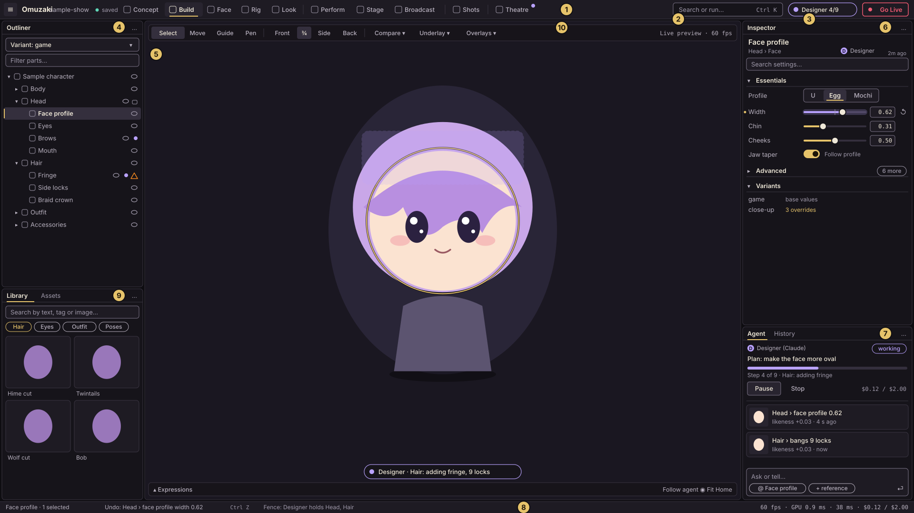
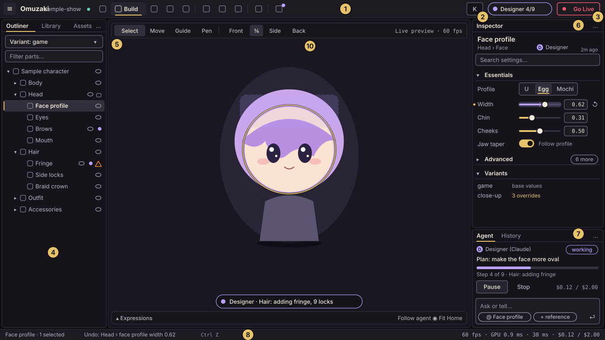
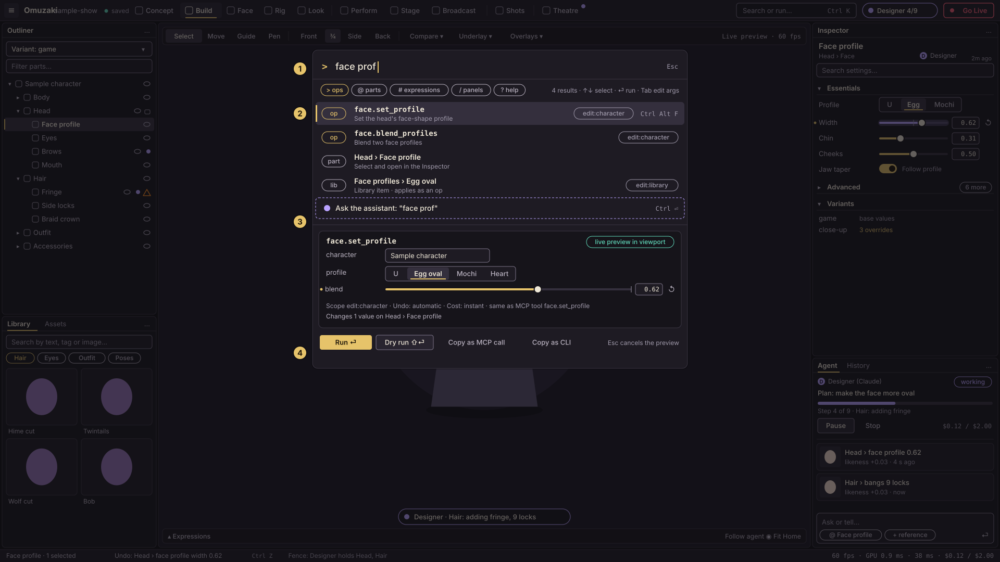
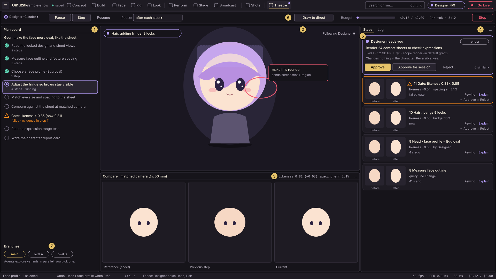
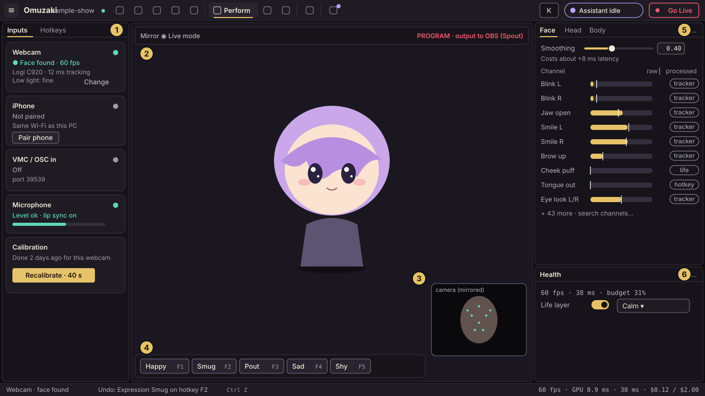
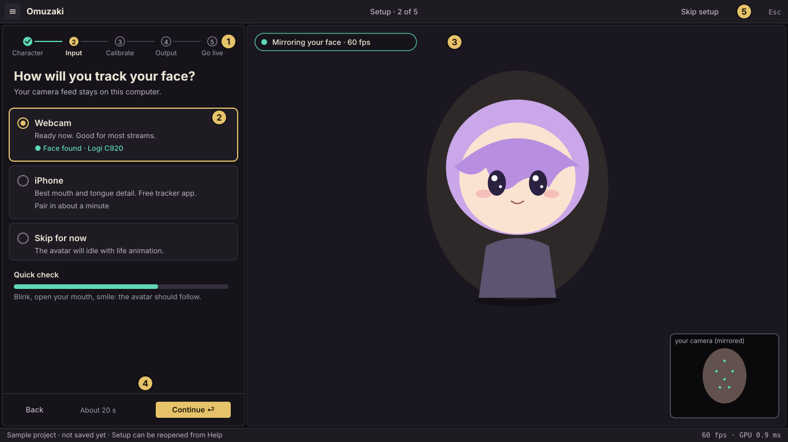

# App shell: layout, workspaces and flows

> Part of the UX direction. Principles are in `principles.md` (cited as P1 to P12), components and tokens in `design-system.md`. The wireframes are SVG files in `wireframes/` (open them at full size; the callout numbers match the legends below).

This page is the layout contract for `omuzaki-ui`. An implementer should be able to build the shell, the docks and each panel's structure from it without asking. Phase 1 builds the shell, the viewport, the outliner, the inspector, the command palette and the history (spec §35); the rest is specified here so the shell is designed for it.

## 1. Anatomy

Every screen has the same seven regions.

| Region | Size (at 100% UI scale) | Holds |
|---|---|---|
| **Top bar** | 40 pt | app menu, project name and save state, workspace tabs, search field, agent chip, Go Live |
| **Left dock** | 300 pt wide (240 at ≤1599 pt) | Outliner, Library, Assets, workspace panels |
| **Center** | the rest | the **primary panel**: the viewport (3D) or a canvas (Concept sheet, Shots timeline) |
| **Right dock** | 360 pt wide (300 at ≤1599 pt) | Inspector above, Agent and History below |
| **Bottom dock** | 0 pt when collapsed, 160 to 320 pt open | workspace panels: expression strip, timeline, stress test |
| **Status bar** | 24 pt | selection, **undo label**, fence note, health meter, agent budget |
| **Overlays** | n/a | command palette, approval stack, toasts, notification log, dialogs |

Each docked panel is a card (radius 6, a hairline `line` outline, its tab bar on `bg2` and its body on `bg1`) on the window's `bg0`, 6 pt from the next card and from the window's edges, so every pane reads as its own place. A panel's body sits 12 pt in from its card's sides and 10 pt from its top and bottom, so nothing touches the card's edge; the primary panel (the viewport, the stage) runs to the card's edge.

Supported window sizes run from **1280×720** (minimum, enforced) to 4K. The wireframes show **1920×1080** and **1366×768**, the two sizes every panel is reviewed at. Sizes are in egui points, so they hold at any OS scale.


### App menu (the ≡ button)

| Menu | Items |
|---|---|
| **File** | New project, Open, Open recent, Save a named version…, Export (VRM, glTF, …), Close project |
| **Edit** | Undo and Redo (with labels), History, Copy op call for the selection, Preferences |
| **View** | Show panel (every registered panel), Reset layout, Lock layout, Density, UI scale, Theme, Full screen |
| **Agents** | Connect an agent, Sessions, Grants, Open the Theatre |
| **Help** | Run setup again, Shortcut sheet, Copy screen as text, Documentation, About and licences |

Every item is an op or a registered action, so it is also in the palette (P8).

### Width classes

| Class | Width | What changes |
|---|---|---|
| XL | ≥ 1920 | as drawn in `build-1920.svg` |
| L | 1600 to 1919 | as XL |
| M | 1366 to 1599 | docks 240 and 300 pt; Library becomes a tab beside the Outliner; every workspace tab keeps its label (S shows the inactive ones as icons) |
| S | 1280 to 1365 | left dock collapses to a 48 pt icon rail that opens as an overlay drawer; inspector 288 pt; inactive workspace tabs show only an icon; Go Live becomes an icon with a tooltip |

If the window is shorter than 800 pt, Agent and History merge into the Inspector's tab group (Inspector | Agent | History). Collapse order when space runs out: bottom dock, then Library, then Agent/History into a tab, then the left dock to a rail, then the right dock to a rail. The viewport never goes below 480×320 pt; the Inspector is the last panel to collapse.

## 2. The two reference screens

### Build workspace at 1920×1080



| # | Element | Behaviour |
|---|---|---|
| 1 | **Workspace tabs** | Pipeline order in four groups: Concept, Build, Face, Rig, Look · Perform, Stage, Broadcast · Shots · Theatre. Ctrl+1 to Ctrl+9 jump to tabs 1 to 9, Ctrl+0 to Theatre. Theatre shows a violet dot while any agent session runs. Only workspaces whose panels exist are shown (section 3). |
| 2 | **Search or run** | Ctrl+K opens the command palette (section 8). The field is a button, not a text input, so typing never lands in it by accident. |
| 3 | **Agent chip and Go Live** | The chip shows the active session ("Designer 4/9") and opens a popover: pause, step, stop, grants, budget, "Open in Theatre". With no session it reads "Agents" and shows how to connect one. **Go Live** is outlined red and is never filled until you are live; it opens a small popover (which outputs, test pattern, Start) and Start is a two-step confirm (P10). |
| 4 | **Outliner** | The part tree (section 6), with a Variant switcher and a filter. |
| 5 | **Viewport** | The live character (section 5). The two-tone ring is the selection; the dashed violet region and the caption pill are an agent edit in progress. |
| 6 | **Inspector** | Context-sensitive parameters in Essentials, Advanced and Variants sections (section 7). A violet slider is a value an agent just set. |
| 7 | **Agent and History** | One tab group. The Agent tab shows sessions, steps and the prompt box; History is the single timeline (sections 9 and 10). |
| 8 | **Status bar** | Selection, **Undo: label and shortcut**, the fence note ("Designer holds Head, Hair"), the health meter, agent spend. |
| 9 | **Library** | Search by text, tag or image; tiles preview on hover (P2). |
| 10 | **Viewport toolbar** | Tools, camera views, Compare, Underlay, Overlays, and the frame readout. |

### Build workspace at 1366×768



Same regions, width class M. The Library moved into a tab beside the Outliner, the workspace tabs keep their labels, the search field is a button showing "K", and the inspector is 300 pt wide. The slider row still fits (section 7) because its label column shrinks first.

## 3. Workspaces and panels

A **workspace** is a saved layout plus a default context, not a mode. Any panel can be opened in any workspace (palette: "Show Library"). This is Blender's definition ("predefined window layouts") and keeps the shell small.

Workspaces and panels **self-register**, like ops (spec §39 rule 2). Nothing edits a central list, so the tab bar and View menu show whatever is compiled in, ordered by group (a workspace's group, a panel's region), then an `order` key, then id. An id registered twice is reported, not silently dropped.

```rust
// The registration contract, in the `omuzaki-ui-api` crate (`registry`, `panel` and `layout` modules).
register_workspace! { id: "build", title: "Build", icon: icons::HAMMER, order: 20, group: Group::Make,
                      default_layout: layouts::build }        // fn() -> layout::Node
register_panel! {
    id: "outliner", title: "Outliner", icon: icons::TREE, region: Region::Left,
    min_size: [240.0, 160.0], order: 10, empty: empty_states::NO_CHARACTER,   // `kind` and `empty` are optional
    build: |ctx| Box::new(OutlinerPanel::new(ctx)),           // ctx: &PanelCtx
}
```

A panel implements `Panel` (`ui`, plus optional `title`, `accessibility_label`, `available`, `palette_entries`). Its `PanelCtx` gives the `Runner` and the actor it runs ops as, this frame's events, typed view models and the theme kind; colours come from the egui style the shell installs. `omuzaki-ui-mock` draws a panel headless and runs the conformance check every panel crate calls.

**How the shell reads it.** `Shell::new` collects the registry once (`shell::registry::collect`) and keeps it: the workspace tabs are `Registry::workspaces`, the View menu's *Show panel* list is `Registry::panels`, and the gallery lists `Registry::stories`, each in the registry's order. The shell builds a panel (`PanelDef::build`) the first time it is shown and keeps the instance for the session, so a panel's own state survives a tab switch, a fold of the docks or a workspace change. It draws the body with `Panel::ui`, or the registered empty state while `Panel::available` is false (a generic notice when the registration has none), and names the region with `Panel::accessibility_label` when the panel gives one. Each frame the panel's `PanelCtx` carries the runner as the person, the events the runner sent since the previous frame (read once per egui frame, so a discarded pass sees the same slice), the shell's view models (today the op log as `HistoryLog`, which the History panel reads) and the theme kind the design system is drawing with.

A workspace's default layout (`default_layout`, in the contract's `layout::Node`) is converted to the shell's own saved format (`shell::layout`) and made safe the way a loaded one is: a panel nobody registered is dropped and reported, a panel listed twice is drawn once, and shares the docking widget would panic on are repaired. A workspace whose layout holds nothing the shell can show is left out (reported); one without a primary panel still opens (reported), and its saved layouts are only held to panels that exist. An id registered twice keeps the first registration in the registry's order and is reported at startup with a log line naming both places (`shell::registry::collect` for workspaces and panels, the gallery for stories). Layouts saved by earlier shells load unchanged: the file format is the shell's, not the contract's.

*Show panel* (View menu, the registered panels in registry order) brings a panel the workspace shows to the front and focuses it. A panel the arrangement lacks joins the tab group of a panel of its region, or gets a column of its own (left panels at the left edge, the others at the right), and the new arrangement is saved like any other change. In a window that folds the left dock to a rail, a left panel opens as the drawer.

| Workspace | What you do there | Default layout | Key panels | Features | Phase |
|---|---|---|---|---|---|
| **Concept** | brief, mood board, import or generate a sheet, read the design, lock it | left: Brief, Mood board · center: **Sheet canvas** (views side by side, zoom, overlays) · right: Analysis (proportions, outline, palette), Agent | Brief, Mood board, Sheet canvas, Analysis, Rights | CO-01 to CO-10 | 3 |
| **Build** | shape the character from parts | as `build-1920.svg` | Outliner, Library, Viewport, Inspector, Agent, History | CB-* | 1 |
| **Face** | eyes, brows, mouth, expressions | center: viewport locked to the close-up camera · bottom: **Expression strip** (thumbnails) · right: Inspector with the Eye, Brow, Mouth designers; Channels | Expression strip, Channels (all 52 + extras, searchable), Range test | FE-*, CB-20 to CB-25 | 1 (designers), 3 (library, range test) |
| **Rig** | skeleton, weights, physics | center: viewport with bone and weight-heatmap overlays · right: Inspector (spring chains, colliders) · bottom: **Stress test** (pose battery contact sheet, clipping report) | Skeleton tree (in Outliner), Weights, Physics, Stress test | RG-* | 1 to 3 |
| **Look** | palette, materials, light, post | right: Palette slots, Material · left: Light rigs · toolbar: Live ↔ Quality | Palette, Materials, Light rigs, Post | LK-* | 1 to 3 |
| **Perform** | inputs, calibration, channels, life layer, hotkeys | `perform-1366.svg` | Inputs, Hotkeys, Channels, Health, Life layer | PF-* | 2 |
| **Stage** | scenes, props, cameras | left: Scene tree, Props library · center: viewport with camera gizmos · right: Inspector | Scene tree, Props, Cameras | ST-* | 2 to 5 |
| **Broadcast** | outputs, platform events, redeems, moderation | left: Outputs · center: Event feed · right: Rules (a table; the node graph is a tab in the center) | Outputs, Events and chat, Rules, Panic and moderation | BR-* | 2 |
| **Shots** | takes, timeline, renders, emotes | center: viewport · bottom: **Timeline** with curve editor · right: Takes, Render queue | Timeline, Score, Takes, Render queue, Emotes | SH-* | 4 |
| **Theatre** | watch and steer agents | `theatre-1920.svg` | Plan board, Steps, Compare, Branches | spec §13 (TH-*) | 3 |
| **Explore** | for non-artists: "show me six takes", more like this, mix two takes, lock what you like and re-roll the rest | to be designed | Takes grid, Branches | CB-93, CO-09 | 3 |
| **Report card** | one page per character: likeness, readability, expression coverage, perf budget, licence; character sheets (turnaround, expression sheets) | to be designed | Report card, Sheets | CB-92, EX-10 | 1 (sheets), 3 (report card) |
| **Collab** | invite people to a shared stage; presence; characters look at each other | to be designed | Session, Participants | ST-10, ST-11 | 5 |
| **Review** | share a web review link; pin comments to parts, frames or views; turn them into agent tasks | to be designed | Comments, Tasks, Review links | VC-05, VC-07 | 5 |
| **Script console** | run op sequences, record macros from UI actions | to be designed | Console, Macros | PL-02 | 2 |
| **Settings** | first-run wizard, language, accessibility, privacy and consent, connectors and keys, models, updates, team roles | to be designed | Wizard, Language, Privacy, Connectors, Models, Team | SE-*, CN-05, ML-01, VC-10 | 1 to 5 |
| **Companion app** (phone) | pair a phone, send tracking, use the remote deck and the program preview | to be designed in a phone UX pass | Pairing, Deck, Preview | PF-09 to PF-11 | 5 |

The last seven rows are placeholders, one line each: the UX agent will design their layouts and wireframes later. They are listed now so that no feature in the spec lacks a home in the shell.

Phase 1 ships Build (with the Face and Look inspector sections reachable through the Outliner) and the shell. Tabs appear as their workspaces land; there are no "coming soon" tabs.

## 4. Docking rules

1. **One primary panel per workspace** in the center (the viewport or a canvas). It can't be closed or hidden. Ctrl+Space maximises the focused panel; Esc or the same keys restore it.
2. **Panel kinds.** *Primary* (viewport, canvas, timeline when it is primary), *dockable* (everything else), *overlay* (palette, approval stack, toasts, notification log: never docked).
3. **Minimum sizes.** Left panels 240×160 pt, right panels 288×160 pt (an inspector row needs 288 pt: 8 padding + 96 label + 6 + 80 track + 6 + 56 value + 4 + 24 reset + 8 padding), bottom panels 160 pt high. Below that, a dock collapses (section 1).
4. **Drop zones.** Dragging a tab shows zones on the edges (split), the centre (join the tab group) and the tab bar (reorder). The target is filled with the accent at 22% and outlined 2 pt. **Every drag has a menu equivalent** in the panel's "⋯" menu: Move to Left, Right, Bottom, New window, Reset layout (WCAG 2.5.7).
5. **Panels never close themselves.** When a panel can't work (no character selected), its body shows a disabled state with the reason and the fix. Closing is a user action; closed panels return through the View menu or the palette ("Show Inspector"). Cubism's panels that vanish on mode change are the cautionary tale.
6. **Layouts belong to the user, not the project.** Saved per workspace in `~/.config/omuzaki/layouts/<workspace>.toml` (platform equivalent elsewhere). A project only remembers its last workspace. "Reset layout" is always in the "⋯" menu and the palette. Layouts export and import as files for teams.
7. **Pop-out.** The Viewport, Theatre, Timeline and Channels can become OS windows (egui multi-viewport) for a second monitor. Closing the window re-docks the panel. A popped-out panel keeps its shortcuts.
8. **Lock layout** (View menu, Ctrl+Shift+L) disables dragging. It turns on automatically while live (P10).
9. **Library choice.** The docking widget is `egui_tiles` behind a `omuzaki-ui::dock` module: n-ary splits and serde-able trees fit our per-workspace layouts, and Rerun built it for its own viewer (github.com/rerun-io/egui_tiles). It has no tab close buttons, which we want to draw ourselves anyway. `egui_dock` is the alternative (tab drag-out into egui windows, close buttons). Whichever is chosen sits behind our own `Dock` trait so it can be swapped. The spike should confirm focus, keyboard and AccessKit behaviour for tab strips before panels are built on it.

## 5. The viewport

The viewport is a wgpu render drawn through an `egui_wgpu` callback (spec §9). Its chrome is egui, drawn over it with 94% opaque panels so the character stays visible beneath.

- **Camera:** orbit (middle drag, or Alt+left drag), pan (Shift+middle drag), zoom (wheel, pinch). Buttons for Front, ¾, Side, Back (keys 1 to 4 when focused, like VRoid's number keys). **F** frames the selection, **Home** frames the character. Adding or selecting a part auto-frames it when "Auto-frame" is on (VRoid does this for accessories).
- **Tools** (toolbar, top left): Select, Move, Guide (hair guide curves, CB-32), Pen (draw to direct, P4). Gizmos draw only for the active tool.
- **Selection:** a two-tone outline (1.5 pt black at 70% outside, 2 pt accent inside) so it reads on any backdrop. Hover is a 1 pt accent outline.
- **Agent edit:** a dashed violet region around the touched part, a violet glow on the part for 900 ms after each op, and a caption pill at the bottom ("Designer · Hair: adding fringe, 9 locks"). Under reduce-motion, the glow is a static violet outline for 2 s.
- **Compare menu:** off, side by side, overlay (opacity slider), difference heatmap (CB-03, `render.compare`). Underlay shows the locked sheet view at an opacity (CB-25). Overlays toggles: bones, colliders, feature-layout ratios (CB-12), safe frames (SH-08), stats.
- **Live ↔ Quality** toggle (LK-05) and a resolution-scale control for slow GPUs. The frame readout shows fps and GPU ms.
- **Program badge:** when this viewport feeds an output, a red "PROGRAM" badge appears (P10).
- **Context menu (right click):** Select part here, Frame, Hide others, Copy op call for the selection, Ask the assistant about this.
- **Background:** the character's stage backdrop, or a neutral `bg.0`. The UI never tints the render.
- **Performance:** the callback renders only when the scene is dirty or the camera moves, except while performing. Interactive camera moves render at full rate.

## 6. Outliner (the part tree)

Rows are `[indent guides][chevron][type icon][name][state icons]`, 26 pt high (24 compact).

- **Tree:** Character › Body, Head (Face profile, Eyes, Brows, Mouth), Hair (clumps), Outfit, Accessories. Skeleton and Variants appear as their own roots when the Rig workspace is active. The top control is the **Variant** switcher (game, close-up, …), because variants change what the tree shows (CB-13).
- **State icons**, right-aligned, each with a tooltip and a screen-reader label: eye (visibility), lock (fenced by an agent or locked by you), violet dot (touched by an agent since you last looked), warning triangle (a failing gate on this part).
- **Selection:** click selects; Ctrl and Shift extend; the inspector follows. Selected rows show a 2 pt accent bar on the left and a `bg.4` fill, so it doesn't rely on colour alone. When the panel is unfocused the bar is hollow.
- **Keyboard** (when focused): Up and Down move; Left collapses or goes to the parent; Right expands or goes to the first child; Home and End; Enter focuses the inspector; F2 renames; Delete removes (undoable); Ctrl+D duplicates; Ctrl+F or typing starts the filter.
- **Filter:** fuzzy; matching rows keep their ancestors visible; matched text is emphasised.
- **Drag:** reorder only where the layering allows it (outfit layers); a drop line shows the target; Esc cancels. Every drag also has "Move up / down" in the context menu.
- **Virtualised:** rows come from a flat visible-rows cache keyed on `(DocVersion, expanded set, filter)` and are drawn with `ScrollArea::show_rows`. A 10,000-row tree costs the same as a 40-row one (`design-system.md` rule 3).

## 7. The inspector pattern

The inspector shows the selected thing's parameters. It is **generated from op schemas** with hand-built overrides, so every op has a UI from day one and the UI can't drift from MCP (P8).

```
 header   Face profile                         D Designer  2m ago        <- name, path, last editor
 search   [ Search settings…                                       ]
 ▾ Essentials                                                           <- at most 7 controls (P5)
 ●  Width    ───────●──┆───   [ 0.62 ]  ↺                              <- ParamSlider
 │  │        │        │          │       └ reset: hidden at default, its space is kept
 │  │        │        │          └ numeric entry: click or Enter, mono, right-aligned
 │  │        │        └ default tick
 │  │        └ track, filled from the default (or the left end for one-sided ranges)
 │  └ label (38% of the row, min 96 pt)
 └ "modified from default" dot (accent)
 ▸ Advanced                                         [ 6 more ]
 ▾ Variants    game: base values · close-up: 3 overrides
```

- **Sections:** Essentials open by default; Advanced collapsed with a count badge; both remembered per section per user. A section header click toggles it, Ctrl+click opens it and collapses the rest (Blender's panel gesture). Search opens whatever matches.
- **Generated controls:** the schema type maps to a component: number with `minimum`/`maximum` → ParamSlider; integer with few values or an enum → Segmented (≤ 5) or a dropdown; boolean → Toggle; colour → ColourField; `number[]` with `x-ui.widget = "curve"` → CurveEditor; id reference → a picker with thumbnails. Extra schema keys: `x-ui.level`, `x-ui.group`, `x-ui.unit`, `x-ui.step`, `x-ui.decimals`, `x-ui.default`. Hand-built inspectors (eye designer, hair guides) replace a generated one by registering for the same part type.
- **Row markers:** *modified* dot (accent) when the value differs from the default; **V** badge when overridden in the current variant (hover: the base value, with "Revert to base"); a violet underline and glow for 900 ms (then a quiet violet tick until you hover) when an agent set it; a lock when fenced; a live meter laid over the track when a tracker drives it.
- **Multi-selection:** mixed values show "—"; dragging sets all of them (one transaction).
- **Editing:** drag the handle, click the track (jumps there), type a number, or use the keyboard (`design-system.md`, ParamSlider). Shift is fine control, ×0.1. One gesture is one transaction; Esc rolls it back.
- **Provenance footer** for library items and generated assets: source, licence and commercial status (spec §7), with a warning chip when `unknown`.
- **Empty:** nothing selected shows "Select a part to edit it" and a mini part picker (see section 13).

## 8. The command palette



| # | Element | Behaviour |
|---|---|---|
| 1 | **Input and modes** | Ctrl+K. Plain text searches everything. Prefixes narrow it: `>` ops, `@` parts, `#` expressions, `/` panels and workspaces, `?` help. The chips under the input are clickable. |
| 2 | **Results** | One list, ranked: exact name, prefix, then fuzzy; anything applicable to the current selection is boosted; recents are boosted. Each row shows a **kind chip** (op, part, lib), the **name** (ops in mono, the real MCP name), a summary, the **scope badge** (`edit:character`) and the **keybinding**. Ops the actor can't run stay visible, greyed, with the reason ("needs `spend`: ask the person"). The last row, "Ask the assistant: …", hands the text to the built-in assistant (Ctrl+Enter). |
| 3 | **Inline args form** | Tab (or choosing an op with arguments) opens the schema-generated form under the list. Edits dry-run with a 120 ms debounce and **preview in the viewport** with a "live preview" chip. Below the form: scope, undo behaviour, cost hint, and "same as MCP tool `face.set_profile`". |
| 4 | **Actions** | **Run** (Enter, one undo step), **Dry run** (Shift+Enter: shows the patch, changes nothing), **Copy as MCP call**, **Copy as CLI**. Esc cancels and removes the preview. |

Rules: the palette is a combobox (input plus listbox) with full keyboard and screen-reader support. It opens in under one frame because the op list is built once from the registry and filtered by a prebuilt index. Settings, workspaces, panels, library items and recent files are indexed too. Ops that need many arguments show Essentials first (P5). Queries (read-only ops) run and show their result inline instead of changing anything.

## 9. The History panel

One list for the whole project, newest on top. It is the same widget the Theatre uses (section 11), not a second timeline.

```
 ◆ Designer   Hair › bangs 9 locks        likeness +0.03    now     [Adjust]
 ◆ Designer   Head › face profile = Egg   likeness +0.06    4 s
   You        Eyes › size 0.42 → 0.55                       1 m
 * v3 "before the oval face"                                14:02       <- named version
   You        Palette › hair colourway Lilac                14:01
```

- **Row:** thumbnail (48 pt, lazy), label, actor chip, metric deltas, age. Rows are a fixed 56 pt so the list can be virtualised; the cause (the prompt line) and the full patch open in a detail popover (hover or Enter). Query ops don't appear unless you tick "Show reads".
- **Click** a row to **preview that state** in the viewport (non-destructive scrub, a "viewing v3" chip with Back). **Enter or "Restore"** goes there with undo; the later rows grey out as **redo**. If you then edit, the abandoned future is kept as a branch (P3).
- **Adjust** on the latest row reopens the op's form with its arguments (Blender's Adjust Last Operation).
- **Named versions** (marked with a star): Ctrl+Shift+S asks for a name. They survive history trimming and show first in a "Versions" filter (the Figma pattern).
- **Compare:** select two rows to open a visual diff: before and after renders plus the parameter diff (VC-03).
- **Filters:** by actor (me, agents, automation), by area (face, hair…), by text.
- **Undo and redo** also appear in the status bar and Edit menu with their labels. Ctrl+Z and Ctrl+Shift+Z (or Ctrl+Y) work from anywhere except a text field being edited.
- **Conflicts:** an undo that `Conflict`s (later edits touched the same fields) opens a card that lists the fields and offers "Undo anyway (overwrite later edits)", "Keep", or "Branch from here".
- **Virtualised.** 50,000 records scroll as smoothly as 50.

## 10. The Agent panel, approvals and grants

The Agent tab is the compact, always-available view of agent work. The Theatre is the full one.

- **Sessions.** One row per agent session: name and model, state (working, waiting for you, paused, idle), current plan item, step count, spend. External agents (Claude Code over MCP) and the built-in assistant look the same; an icon tells them apart.
- **Prompt box** (built-in assistant only). Placeholder "Ask or tell…". Context chips show what rides along: `@ Face profile` (the selection), `+ reference`, `viewport` (a snapshot). Chips are removable. Enter sends; Shift+Enter breaks the line.
- **Steps** are the same cards as in History and the Theatre (`design-system.md`, step card), shown inline in the conversation.
- **Approval card** (`design-system.md`) appears here and as a stack at the top right of the window when an op needs a decision (a `Denied` op that was queued, a plan to approve, an elicitation). The agent's row reads "waiting for you" until it's answered, and the window title and taskbar get an attention marker when the app is in the background (opt-in OS notification).
- **Grants popover** (from the top-bar chip or the panel header):

```
 Designer (Claude Code)                          session only
 [x] read              [x] edit:character     [x] edit:scene     [x] render
 [ ] broadcast         [ ] publish            [ ] spend  $0 of [ 2.00 ]
 [ ] net               [ ] fs: [ + add folder ]            [ ] native
 [ Revoke all ]                              [ Grant for this project ▾ ]
```
  Defaults match `Grants::agent_default()`: read, edit:*, render. The widest grant is explained in words ("Designer can spend up to $2.00 on connectors"). `broadcast`, `publish`, `spend` and `native` grants use the two-step confirm.
- **Batching.** Identical pending requests collapse ("6 similar steps: Approve all"). Approving a plan approves the in-scope steps inside it; only steps that cross a scope boundary or hit a gate ask again.
- **Stop** is always visible while a session runs, as is the budget.

## 11. The Build Theatre



The dedicated workspace and pop-out window from spec §13.

| # | Element | Behaviour |
|---|---|---|
| 1 | **Plan board** | The agent's plan as a checklist: done (filled green with a check), running (violet ring), planned, failed gate (triangle plus text). Each item links to its steps; clicking one filters the Steps list. |
| 2 | **Live viewport** | Follows the agent (toggle "Following Designer"). The caption pill names the current op. **Draw to direct:** with Pen on, circle a region and type a note; it appears as a red region with a pill, and goes to the agent as an image plus coordinates once you press Send (several notes can be batched). |
| 3 | **Compare strip** | Reference, previous step and current at a matched camera, with the metrics (likeness, spacing error). A toggle switches it to **Branches**: each branch rendered live side by side, with "Keep this" (apply its ops here, keep the others as branches). |
| 4 | **Steps** | A card per transaction: label, actor, cause, before and after thumbnails, metric deltas, age. **Explain** asks the agent for its rationale in plain words; **Rewind** restores to just before the step (or branches from it). Review buttons (Approve, Reject with comment) appear on pending steps and always in "pause after each step" mode. A failed gate is a card with a warning border and the evidence image. |
| 5 | **Approval card** | Pinned above the steps while a decision is pending. |
| 6 | **Controls strip** | Pause, Step, Resume; the **Pause mode** (after each step, after each plan item, at gates only, never); Draw to direct; the **budget meter** (money, tokens, time) with its stop limit; Stop. |
| 7 | **Branches** | Chips for `main` and each exploration. |

Recording: "Export making-of" renders the step thumbnails with captions into a time-lapse (SH-09). Replay re-runs the op log elsewhere. The Theatre shows a "recording" chip while capturing.

## 12. The Perform workspace and calibration



| # | Element | Behaviour |
|---|---|---|
| 1 | **Inputs** | One card per source: Webcam, iPhone, VMC/OSC, Microphone. Each shows a status word with a dot (never the dot alone): "Face found · 60 fps", "Not paired". Failures name a fix: "No camera found. Plug one in or pick another." A source that disappears (Warudo's vanishing webcam) raises a toast with a Retry action and auto-retries every 3 s. |
| 2 | **Program viewport** | Shows the PROGRAM badge and the output route. Mirror and Live mode toggles. |
| 3 | **Camera picture-in-picture** | The mirrored camera with tracked landmarks, so you can see what the tracker sees. |
| 4 | **Expression strip** | Buttons with their bound keys. Clicking binds on the first click when empty. The Hotkeys tab is a table: Trigger (key, MIDI, gamepad, Stream Deck, chat redeem), Action, Test, with **conflict detection** and a key-capture that accepts any key, including Tab (VNyan's hotkey node refuses it). |
| 5 | **Channels** | Each channel shows a **meter** (processed fill, raw tick), its **owner** chip (tracker, audio, AI, life layer, hotkey: PF-23) and the response curve behind a disclosure. The Smoothing control states its cost: "Costs about +8 ms latency" (PF-21). |
| 6 | **Health and Life layer** | fps, latency, tracking time, budget use, plus the life-layer preset and switch. |

**Guided calibration (PF-20)** is a full-viewport overlay on the live avatar, so you see the effect as you do it. It follows the prototype's `calui`: a step label, a large countdown, the prompt in large type, step dots, a warning line ("face lost, move back into frame"), and a Cancel button that is always there. Differences from the prototype and from the competitors: Esc cancels at any point and keeps the previous calibration (VNyan can't cancel); the result is saved per device and camera (VSeeFace can't persist); a summary lists the measured ranges with Undo; and a 5 s "Calibrate neutral only" option covers the quick case, as the prototype's second button does. The whole run takes about 40 s.

## 13. Empty states

An empty panel is a bug (P7). Every one has a headline (what this is), one line of why, one primary action, and at most one secondary.

| Where | Headline | Primary action | Secondary |
|---|---|---|---|
| No project open | "Start with a character" | **Open the sample character** | New from a sheet · Import a VRM · Open project |
| Project with no character | "This project has no character yet" | **Create a character** (guided) | Import a model |
| Outliner, nothing selected | "Pick a part to edit it" | (a part picker) | Select by clicking the character |
| Inspector, nothing selected | "Select a part to edit it" | (a mini part picker) | |
| History, empty | "Your changes will appear here" | | "Everything you or an agent does can be undone" |
| Library, no results | "Nothing matches 'twintails'" | **Search by image** | Ask the assistant to make one |
| Agent panel, none connected | "Connect an agent" | **Connect Claude Code** (shows the `omuzaki mcp` command to copy, and the HTTP address) | Use the built-in assistant (needs a key) · What agents can do |
| Perform, no camera | "No camera found" | **Choose a camera** | Pair an iPhone · Use the life layer only |
| Camera permission denied | "Omuzaki can't see your camera" | **Open system camera settings** | Use iPhone tracking |
| Broadcast, no output | "Show your character in OBS" | **Add an output** (recommends the one for your OS) | Test pattern · Open OBS instructions |
| Theatre, no session | "No agent is working" | **Start from a prompt** (recipes: "Create from this sheet", "Set up my first stream") | Connect an external agent |
| Shots, no takes | "Record your first take" | **Record** | Import a clip |
| Search, no results | "No results for 'x'" | Show the nearest match | Ask the assistant |

## 14. The first-run flow (SE-01)



Target: launch to live in under 2 minutes with a webcam (spec §2, SE-01). The flow is a **dock panel beside a live viewport** (not a modal), so the first thing on screen is a moving avatar. It uses the normal shell with workspace tabs hidden until the flow ends or is skipped. Esc or "Skip setup" always works, and Help › "Run setup again" reopens it.

| Step | Screen | What happens | Budget |
|---|---|---|---|
| 0 | **Welcome** (a card over the loaded viewport) | The original sample character is already idling. One line: "Your camera never leaves this computer. Telemetry is off." Language and theme follow the OS (changeable later). One button: **Start**. | 5 s |
| 1 | **Character** | Three large cards with live previews: **Use the sample**, **Create from a sheet or idea** (guided, CB-90), **Import a VRM**. Choosing the sample continues at once. | 10 s |
| 2 | **Input** (drawn above) | Webcam is preselected if a camera exists; the avatar mirrors you immediately with a status chip. iPhone shows a QR or address pairing. "Skip for now" leaves the life layer on. A quick check asks you to blink and smile. | 20 s |
| 3 | **Calibrate** | The guided 40 s overlay (section 12), skippable with sensible defaults; the result is shown on the avatar. | 45 s |
| 4 | **Output** | One recommendation for the OS (Spout, Syphon, NDI, virtual camera) with a **test pattern** and "Open OBS instructions". "Clean output" is one button (the ※ idea from VSeeFace). | 20 s |
| 5 | **Go live check** | Health meter, a saved layout, "You're set". Buttons: **Open Perform**, **Customise the character**, **Close**. | 10 s |

Rules: every screen says what it will do and how long it takes; **Back** is always there; nothing is irreversible; the camera permission request appears on step 2 with its reason on the same screen. If a probe can answer a question, the screen is skipped: one camera means no camera picker (P6).

**Agent-assisted variant.** If an assistant is configured, step 0 also offers "Let an assistant set this up", which runs the "Set up my first stream" prompt (spec §11) in the Theatre with the same approvals. If none is configured, the button reads "Connect an agent" and opens the connect card (section 13). First-run never requires an API key.

**Failure paths.** No camera: skip to the iPhone or life-layer path. Permission denied: the empty state above. Tracker model still downloading: show progress and let the person continue with the life layer. A model download is hash-verified (spec §10) and resumes.

## 15. Notifications, dialogs and errors

- **Toasts** (`design-system.md`): bottom right above the status bar, at most three visible, never focus-stealing. Success and info disappear after 4 s, warnings after 8 s, errors stay. Everything a toast said is kept in the **notification log** (bell in the status bar).
- **Dialogs** are for irreversible actions and for data entry the app can't infer (naming a version). Never for "are you sure?" on undoable things. They trap focus, close on Esc, and name their primary action with a verb ("Delete 3 parts"), not "OK".
- **Errors** render `OpError` as: what happened, what to do next (its `hint`), a Details disclosure with the structured fields. When `field` is set, the message appears under that control and the control gets focus (a palette form or inspector row shows "Enter a number from 0 to 1" in place). An agent reads the same text. Errors from a job show in its progress row with Retry.
- **Banners** (inline, top of a panel) for persistent conditions: "Tracking lost", "Licence gate: this asset can't be published".
- **Licence gate (spec §7).** A blocked `publish` explains which asset and why, with "Replace asset" and "Mark private".

## 16. Keyboard map (defaults; all remappable)

| Scope | Keys (Ctrl is ⌘ on macOS) | Action |
|---|---|---|
| Global | Ctrl+K | command palette |
| | Ctrl+Z · Ctrl+Shift+Z (Ctrl+Y) | undo · redo |
| | Ctrl+S · Ctrl+Shift+S | save (autosave exists) · save a named version |
| | Ctrl+1…9 · Ctrl+0 | workspace tabs · Theatre |
| | F6 · Shift+F6 | next · previous panel |
| | Ctrl+Space | maximise or restore the focused panel |
| | Ctrl+Shift+L | lock layout |
| | Ctrl+/ | shortcut sheet |
| | Ctrl+Alt+P | pause or resume the active agent |
| | Panic | **no default key**: the top-bar button is always there, and setup asks you to bind a key, Stream Deck or MIDI button (PF-05) |
| Viewport (focused) | 1 · 2 · 3 · 4 | Front · ¾ · Side · Back |
| | F · Home | frame selection · frame character |
| | Esc | cancel drag or preview |
| Outliner (focused) | arrows, F2, Delete, Ctrl+D, Ctrl+F | see section 6 |
| Inspector | Tab · Shift+Tab | next · previous control |
| Focused slider | ← → · Shift+← → · PgUp PgDn · Home End | ±step · ±10 steps · ±10% · min · max |
| | Enter or F2 | type a value |
| | Ctrl+Backspace | reset to default |
| | Ctrl+C · Ctrl+V · Ctrl+Shift+C | copy · paste value · copy as MCP call |
| History | ↑ ↓ · Enter | move · preview or restore |
| Palette | ↑ ↓ · Enter · Shift+Enter · Tab · Ctrl+Enter · Esc | choose · run · dry run · edit args · ask the assistant · close |

Single-key shortcuts (the viewport's and the outliner's) act only while that panel has focus and can be remapped or turned off (WCAG 2.1.4). The shortcut sheet lists them and shows conflicts.

## 17. What the shell saves, and where

| What | Where | Why |
|---|---|---|
| Layouts per workspace, expanded sections, palette recents, density, theme, UI scale | user config dir, as registered settings (`docs/design/settings.md`) | taste belongs to the person |
| Last workspace, window title | `project.toml` | convenient on reopen |
| Grants for "this project" | `.omuzaki/grants.toml` (never committed) | permissions are local trust decisions |
| Op log, history, named versions, autosave snapshots | `.omuzaki/` | recoverable, travels with a copied project folder |
| Calibration | user data dir, keyed by device and camera | belongs to a person and a camera, not a project |

## 18. Build order and open contract questions

Suggested slices for phase 1 (each is one fenced task): (1) shell skeleton (window, top bar, status bar, workspace registry, dock module, theme apply); (2) design-system components with the kitchen-sink gallery and kittest snapshots; (3) viewport panel host and camera; (4) outliner; (5) schema-driven inspector; (6) command palette; (7) History panel and status-bar undo; (8) Agent panel, read-only first; (9) approval card and grants; (10) autosave and crash recovery.

Contract gaps this design depends on (each tracked as an issue):
- **Continuous edits**. `Runner` has no way to coalesce a drag into one op record, so 60 drags per second would flood the op log. Needs a scrub or coalesce key on `Request`.
- **Restore to a point, branches, named versions**. `Runner::undo` pops one transaction at a time. History needs "restore to tx N" and "branch from tx N" (VC-01, VC-02).
- **Pending approvals**. `ErrorCode::Denied` says an op "may be queued for approval", but there is no queue type or event. The approval card needs `Event::ApprovalRequested` and a resolve call with a comment and a grant.
- **Panel and workspace registration**: done. `omuzaki-ui-api` holds the contract (#64 part 1), and the shell and the gallery read it (#2042, part 2): no panel, workspace or story is listed in a shared file.
- **`x-ui.*` schema annotations** carried through `schemars` into `OpInfo.schema`.
- **`omuzaki://ui/context` and `ui.*` ops** (principles, "Agent experience").
