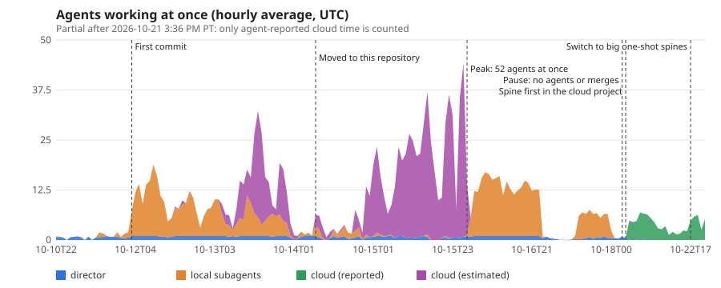
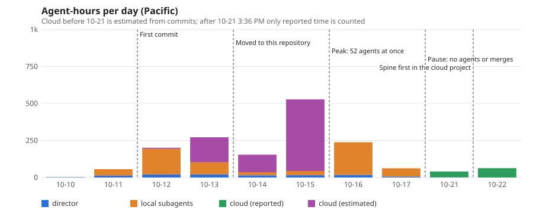
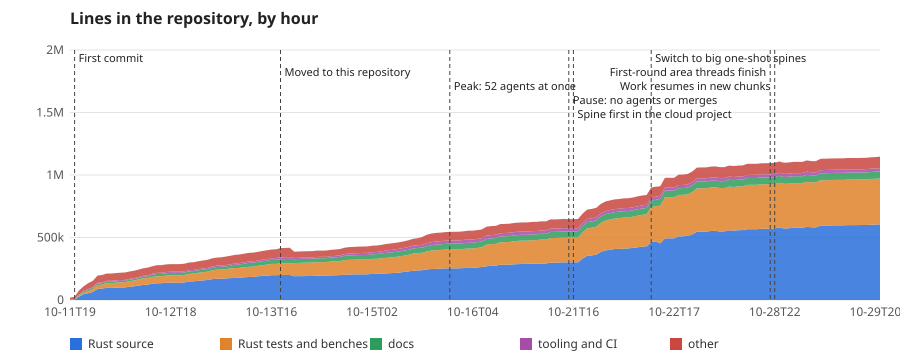
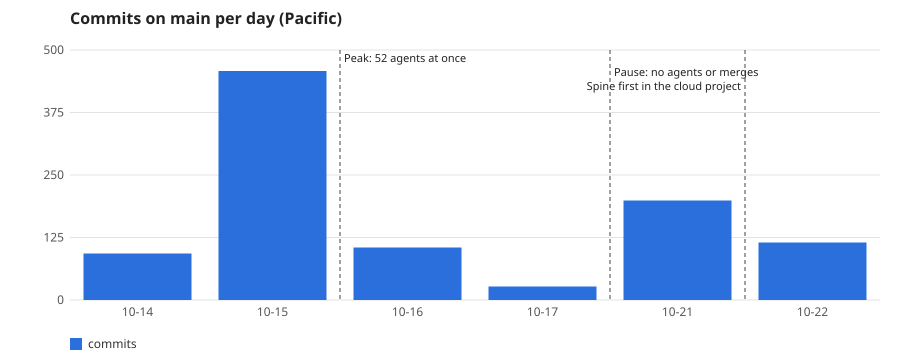
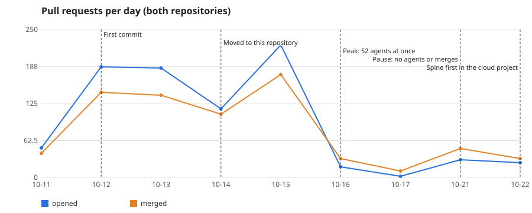
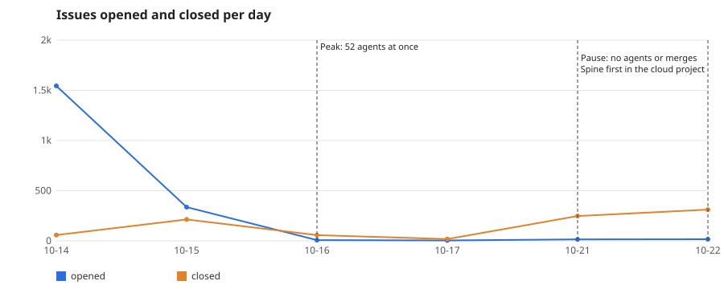
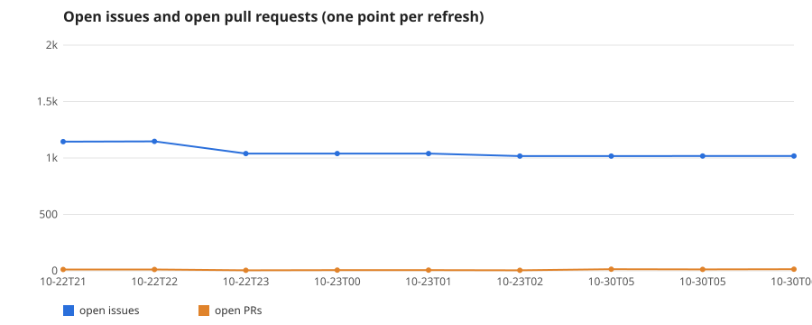
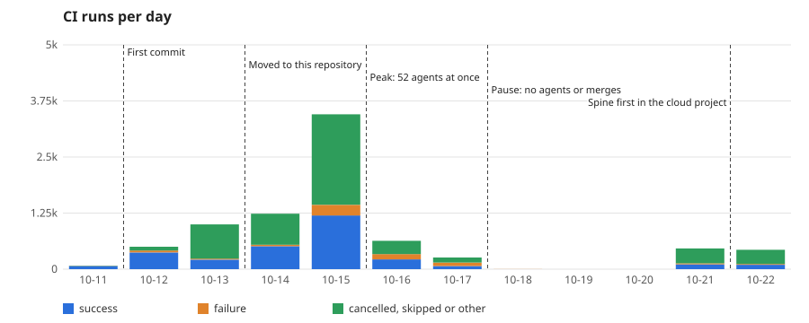

# How Omuzaki was built: the numbers

A record of how this repository was made: agent-hours, how many agents worked at once, lines of code over time, commits,
pull requests, issues, CI runs and code reviews. Omuzaki is built by AI agents (Claude Code, with Codex as a reviewer for
a while) under one human owner. These files are aggregates only: counts and hours per day or per time bucket, with no
conversation content, task descriptions or names.

Snapshot refreshed hourly by `refresh.py` (git, GitHub and CI parts); last refresh in `summary.json`. Each dataset below says how far its data is complete.

## The short version

| | |
|---|---|
| Agent-hours | 1,600 (113 Director, 627 local subagents, 859 cloud sessions); see "Coverage" for what is estimated |
| Most agents at once | 52, at 7:25 PM PT on 2026-10-15 (23 local, 51 cloud at their own peak) |
| Lines in the repository | 906,744 (Rust source 468,494; Rust tests and benches 282,002; docs 51,480; tooling and CI 24,438; other 80,330) |
| Commits on `main` | 990 (not counting merge commits) |
| Pull requests | 836 opened and 728 merged (405 and 379 here; 431 and 349 in the earlier repository before the move) |
| Issues (this repository) | 1,918 opened, 773 closed |
| CI runs | 8,043 (6,382 here, 1,661 in the earlier repository) |
| Code reviews | 1,267 recorded (1,244 by Codex) |

## Charts

Drawn by `charts.py` (standard library only) from the CSVs; `refresh.py` redraws them, and the one-page viewer
`index.html` (headline numbers, every chart and the story of how the project was built), on every refresh. Open
`index.html` in a browser.

## Timeline

- **2026-10-10 to 10-13: an earlier repository.** A local Claude Code session (the Director) planned the work and
  dispatched Opus, Sonnet and Haiku subagents, plus Claude cloud sessions; each change was a small pull request with a
  required CI gate. The first commit is at 7:33 PM PT on 10-11.
- **2026-10-14: the move to this public repository.** The code moved here with its history scrubbed; the 1,544 issues
  opened that day are the backlog moving with it, and the 433,462 lines added that day are the import.
- **2026-10-14 to 10-17: the review process at its height.** One pull request per issue, each reviewed by Codex and
  fixed in rounds, through a merge queue. The busiest day for agents was 10-15 (528 agent-hours, mostly cloud
  sessions); the record of 52 agents at once was set that evening.
- **2026-10-18 to 10-20:** no merges and no recorded agent activity.
- **2026-10-21: spine first.** The owner dropped the small-PR, review-gate process. One Opus agent per area now builds
  that area's whole spine in a Claude cloud project, lands its own work and keeps `main` green, with no review gate and
  no required checks ("make it exist first, then make it good"). From 3:36 PM PT on 10-21 almost every commit carries
  `Agent-Lane: cloud`.

## The files

| File | What it holds | Complete through |
|---|---|---|
| `summary.json` | The totals above, plus the coverage of each dataset | (snapshot) |
| `agents_15min.csv` | Average number of agents working in each 15-minute bucket (UTC), by kind | **complete to 2026-10-21 3:36 PM PT, partial after** (see below) |
| `agent_hours_daily.csv` | Agent-hours per day (Pacific), by kind | same as above |
| `loc_hourly.csv` | Lines in the repository at the end of each hour with commits, by category | 2026-10-22 1:00 PM PT |
| `commits_daily.csv` | Commits on `main` per day: count, lines added and deleted, and the `Agent-Lane` and `Agent-Model` trailers | 2026-10-22 12:36 PM PT |
| `prs_daily.csv` | Pull requests opened and merged per day, in this repository and the earlier one | this repository 2026-10-22 1:52 PM PT; the earlier one 2026-10-22 1:46 PM PT (from 2026-10-11 8:45 PM PT) |
| `issues_daily.csv` | Issues opened and closed per day in this repository | 2026-10-22 1:52 PM PT |
| `ci_daily.csv` | CI runs per day and workflow: result counts and wall-clock minutes (start to last update, not billed minutes); the earlier repository's runs are one "all" row a day | this repository 2026-10-22 1:52 PM PT; the earlier one 2026-10-18 8:22 AM PT |
| `backlog_snapshots.csv` | Open issues and open pull requests at each refresh (one row per run) | each row's own time |
| `events.csv` | The milestones drawn as dashed lines on the charts (the first commit, the move to this repository, the peak, the pause, the switch to spine-first work) | kept by hand; add a row when something changes how the work runs |
| `reviews_daily.csv` | Code reviews per day by reviewer, model and verdict, with blocking findings | **2026-10-17 6:21 PM PT**; the reviews from then until the review gate ended on 10-21 are missing |

## Coverage: what is measured and what is estimated

- **Director and local subagents** (`director`, `opus_local`, `sonnet_local`, `haiku_local`): measured from the Claude
  Code session logs on the machine they ran on. An agent counts as working between two of its log events less than 10
  minutes apart; a longer gap counts as idle. The earliest surviving log is from 3:00 PM PT on 2026-10-10. Complete up
  to the move to the cloud project.
- **Cloud sessions before 2026-10-21** (`cloud_estimated`): cloud sessions leave no log on that machine, so their time is
  estimated from their commits: commits on one branch less than an hour apart form one working span, which starts 20
  minutes before its first commit. Treat these hours as an estimate.
- **Reported cloud work** (`cloud_reported`): time reported by the agents themselves, through `Agent-*` commit trailers
  and activity markers in pull-request comments.
- **After 3:36 PM PT on 2026-10-21 the agent numbers are partial.** The area agents in the cloud project commit under
  the project's identity and report through trailers, so only their reported time is counted (82 hours to the
  snapshot). That is an undercount: the cloud project's own usage records are the full source for this period.
- **Lines of code** are counted at the last commit of each hour on `main`, and before the move on the earlier
  repository's `main`. "Other" includes data files and assets.
- **Commit trailers** (`Agent-Lane`, `Agent-Model`) were added in mid-October and the squash merges before 2026-10-21
  mostly carry none, so those commits count as "unreported".

## Not included

Anything that isn't an aggregate count of work: conversation content, task descriptions, agent and session ids, branch
names and titles from the earlier repository, token counts and spend, and anything about the machines the work ran on.
